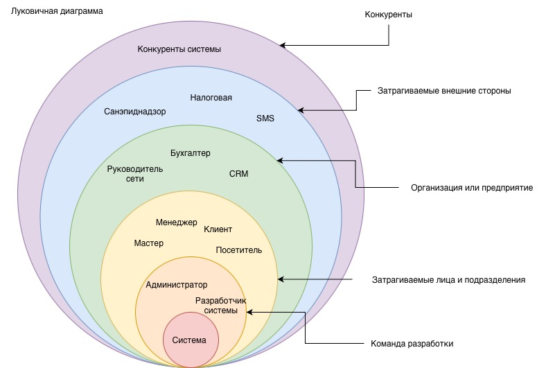

# БСА01_Заинтересованные стороны (Стейкхолдеры)

## 1. Описание

Заинтересованные стороны — это ключевое понятие бизнес-анализа. Это люди, группы лиц или организации, которые могут влиять на систему, оказаться под её влиянием или считать себя затронутыми её внедрением и работой. Выявление стейкхолдеров и их потребностей необходимо для формирования корректных требований к системе.

В рамках проекта по внедрению системы онлайн-записи для сети барбершопов были выявлены следующие группы заинтересованных сторон.

## 2. Каталог заинтересованных сторон

В таблице ниже представлен список стейкхолдеров с распределением по категориям, ролям в проекте и уровнем взаимодействия с системой.

| Заинтересованная сторона                         | Категория ЗС                           | Роль в проекте                                | Уровень контактности с системой |
| :---------------------------------------------------------------------- | :------------------------------------------------ | :-------------------------------------------------------- | :---------------------------------------------------------- |
| **Незарегистрированный посетитель** | Затрагиваемые стороны         | Посетитель                                      | Конечный пользователь                   |
| **Зарегистрированный посетитель**     | Затрагиваемые стороны         | Клиент                                              | Конечный пользователь                   |
| **Мастер**                                                  | Затрагиваемые стороны         | Пользователь системы                   | Конечный пользователь                   |
| **Менеджер**                                              | Затрагиваемые стороны         | Пользователь системы                   | Конечный пользователь                   |
| **Администратор**                                    | Затрагиваемые стороны         | Пользователь системы                   | Конечный пользователь                   |
| **Разработчик системы**                         | Проектная команда                 | Команда разработки и внедрения | Создают систему                               |
| **Руководитель сети**                             | Организация системы             | Выгодоприобретатель                    | Не общаются с системой                   |
| **CRM**                                                           | Взаимодействующие стороны | Интегрируемый сервис                   | Смежная система                               |
| **Бухгалтер**                                            | Затрагиваемые стороны         | Получатель данных                         | Не общаются с системой                   |
| **SMS-шлюз**                                                  | Взаимодействующие стороны | Внешний сервис                               | Смежная система                               |
| **Налоговая**                                            | Регулятор                                | Контролирующий орган                   | Затрагиваемые внешние стороны    |
| **Санэпиднадзор**                                    | Регулятор                                | Контролирующий орган                   | Затрагиваемые внешние стороны    |
| **Конкуренты**                                          | Конкуренты                              | Внешнее окружение                         | Затрагиваемые внешние стороны    |

## 3. Луковичная диаграмма

Для визуализации близости стейкхолдеров к системе и степени их влияния используется луковичная диаграмма. Она помогает выявить интересы и потребности каждой группы.

### Структура диаграммы

1. **Ядро (Система):** Непосредственно разрабатываемая система онлайн-записи.
2. **Внутренний круг (Конечные пользователи):**
   * Зарегистрированные и незарегистрированные посетители (Клиенты)
   * Мастера
   * Менеджеры
   * Администраторы
3. **Средний круг (Смежные системы и проектная команда):**
   * Разработчики (создают систему)
   * Интеграция с CRM
   * Интеграция с SMS-шлюзом
4. **Внешний круг (Затрагиваемые стороны и регуляторы):**
   * Руководитель сети (Выгодоприобретатель)
   * Бухгалтер (получает данные об оплате)
   * Санэпиднадзор (контроль санитарной обработки)
   * Налоговая (регулятор)
   * Конкуренты (внешнее окружение)

## 4. Роли в проекте

В рамках проекта определены следующие роли, объединяющие сходные функции и интересы:

* **Клиент:** Пользователь, осуществляющий запись на услугу, получающий напоминания и оставляющий отзывы. Может быть зарегистрированным или незарегистрированным.
* **Пользователь системы:** Сотрудники сети (Мастер, Менеджер, Администратор), работающие с системой для управления расписанием, услугами и клиентами.
* **Выгодоприобретатель:** Руководитель сети, инициировавший внедрение системы для развития бизнеса.
* **Команда разработки:** Специалисты, отвечающие за создание, внедрение и техническую поддержку системы.
* **Смежные системы:** Внешние сервисы (CRM, SMS-шлюз), с которыми происходит обмен данными.
* **Регуляторы:** Органы контроля (Санэпиднадзор, Налоговая), задающие нормативы работы системы.
