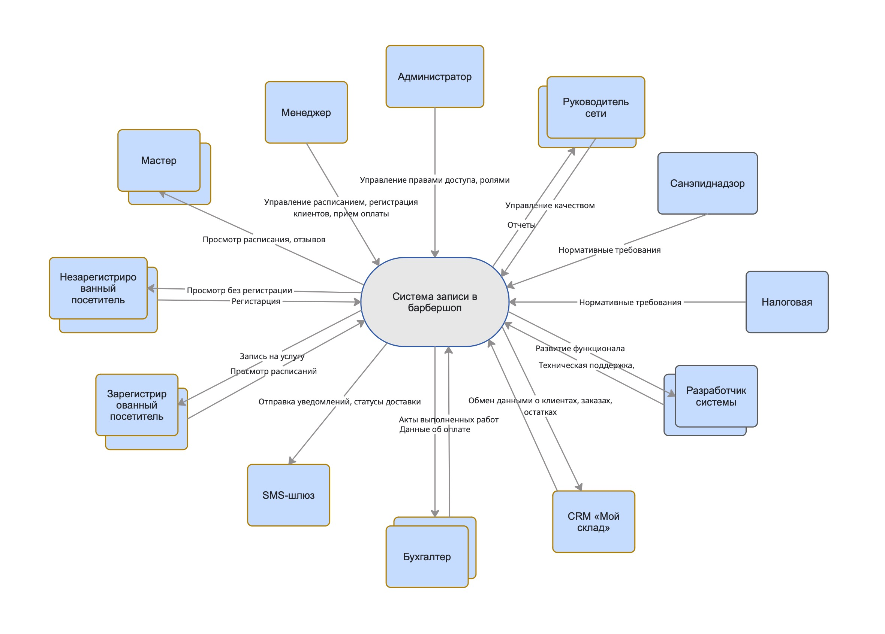

# БСА02_Требования

## 1. Виды и уровни требований

### 1.1 Определение требований

**Требования** — это описание потребностей того, что должно быть реализовано. Они описывают поведение системы, её свойства, характеристики и ограничения. Требования описывают систему во всех её проявлениях, со всех сторон.

### 1.2 Классификация требований (по К. Вигерсу и Д. Битти)

| Вид требования                                     | Определение                                                                                                                               |
| --------------------------------------------------------------- | ---------------------------------------------------------------------------------------------------------------------------------------------------- |
| **Бизнес-требование**                     | Высокоуровневая бизнес-цель организации или заказчиков системы                               |
| **Бизнес-правило**                           | Определяющее или ограничивающее положение, политика или правило                              |
| **Пользовательские требования** | Задачи, которые пользователи должны выполнять с помощью системы                               |
| **Внешние интерфейсы**                   | Взаимодействие с другими системами или пользователями                                                |
| **Ограничения**                                | Ограничения доступных вариантов реализации                                                                    |
| **Системные требования**               | Верхнеуровневые требования к продукту, содержащему несколько подсистем                |
| **Функциональные требования**     | Требуемое поведение системы в определённых условиях                                                    |
| **Нефункциональные требования** | Свойства или особенности системы, ограничения, которые система должна соблюдать |
| **Атрибуты качества**                     | Характеристики свойств, особенности, ограничения системы                                           |

# Контекстная диаграмма

**Контекстная диаграмма** — это диаграмма, характеризующая систему в её связях с окружающим миром (стейкхолдерами и смежными системами). Она отображает потоки информации и управляющие воздействия между системой и внешними сущностями.

**Назначение:**

- Определение границ системы (что внутри, что снаружи)
- Выявление всех внешних взаимодействий
- Понимание ожиданий от системы

# 1. Модель AS IS (текущее состояние)

Модель AS IS отражает существующие процессы взаимодействия стейкхолдеров с системой, выявляя проблемные зоны и узкие места.

### 1.1 Сводная таблица проблем по стейкхолдерам

| Идентификатор | Стейкхолдер            | Действие                                      | Текущий способ              | Проблема                                                                              |
| -------------------------- | --------------------------------- | ----------------------------------------------------- | ---------------------------------------- | --------------------------------------------------------------------------------------------- |
| st00200                    | Клиент                      | Запись/перенос записи              | по телефону, очно          | Клиенту трудно записаться (дозвониться)                     |
| st00200                    | Клиент                      | Получение скидки                       | очно                                 | Клиент не проинформирован о скидке                              |
| st00200                    | Клиент                      | Получение напоминания             | по телефону (частично) | Менеджеру сложно направить SMS всем вручную                |
| st00300                    | Посетитель              | Регистрация                                | очно                                 | Неудобная система регистрации на сайте                      |
| st00300                    | Посетитель              | Запись/перенос записи              | по телефону, очно          | Клиенту трудно записаться (дозвониться)                     |
| st00300                    | Посетитель              | Получение скидки                       | отсутствует                   | Клиент не проинформирован о скидке                              |
| st00300                    | Посетитель              | Получение напоминания             | отсутствует                   | Без регистрации менеджер теряет номера телефонов   |
| st00400                    | Парикмахер              | Оказание услуг                           | очно                                 | Оказана некачественная услуга                                      |
| st00400                    | Парикмахер              | Планирование закупок               | очно                                 | Нехватка материалов                                                         |
| st00400                    | Парикмахер              | Повышение квалификации           | очно                                 | Недостаток знаний о новых технологиях                        |
| st00500                    | Косметолог              | Диагностика кожи                       | очно                                 | Недостаток знаний о новых технологиях диагностики |
| st00500                    | Косметолог              | Выполнение процедур                 | очно                                 | Ошибки в проведении процедур                                         |
| st00600                    | Администратор        | Заказ и контроль материалов   | по телефону, очно          | Нехватка материалов                                                         |
| st00600                    | Администратор        | Выполнение задач                       | по телефону, очно          | Неорганизованность процессов, перегруженность       |
| st00700                    | Бухгалтер                | Учёт доходов и расходов           | очно                                 | Ошибки в учёте данных                                                       |
| st00700                    | Бухгалтер                | Работа с ПО                                  | очно                                 | Ошибки в учёте данных                                                       |
| st00900                    | Руководитель сети | Управление качеством               | очно                                 | Низкое качество сервиса                                                  |
| st00900                    | Руководитель сети | Стратегическое планирование | по телефону, очно          | Сложности масштабирования                                             |
| st00900                    | Руководитель сети | Управление персоналом             | очно                                 | Недостаток ресурсов                                                         |
| st01000                    | Санэпиднадзор        | Контроль саннорм                       | очно                                 | Нарушение санитарных норм                                              |
| st01000                    | Санэпиднадзор        | Реагирование на инциденты      | по телефону, очно          | Недостаток знаний у сотрудников                                   |
| st01000                    | Санэпиднадзор        | Работа с документацией            | очно                                 | Сложности с документацией                                              |

### 1.2 Ключевые проблемы AS IS (группировка)

#### 1.2.1 Проблемы клиентского опыта

| Проблема                                                         | Количество стейкхолдеров |
| ------------------------------------------------------------------------ | ----------------------------------------------- |
| Сложность записи (дозвон)                           | 2 (Клиент, Посетитель)          |
| Неинформированность о скидках                 | 2 (Клиент, Посетитель)          |
| Отсутствие автоматических напоминаний | 2 (Клиент, Посетитель)          |
| Неудобная регистрация                                | 1 (Посетитель)                        |

#### 1.2.2 Проблемы операционной деятельности

| Проблема                                        | Количество стейкхолдеров                          |
| ------------------------------------------------------- | ------------------------------------------------------------------------ |
| Нехватка материалов                   | 2 (Парикмахер, Администратор)                     |
| Низкое качество услуг                | 3 (Парикмахер, Косметолог, Руководитель) |
| Недостаток квалификации           | 2 (Парикмахер, Косметолог)                           |
| Неорганизованность процессов | 1 (Администратор)                                           |

#### 1.2.3 Проблемы учёта и отчётности

| Проблема                                 | Количество стейкхолдеров |
| ------------------------------------------------ | ----------------------------------------------- |
| Ошибки в учёте данных          | 1 (Бухгалтер)                          |
| Сложности с документацией | 1 (Санэпиднадзор)                  |

#### 1.2.4 Проблемы управления

| Проблема                                  | Количество стейкхолдеров |
| ------------------------------------------------- | ----------------------------------------------- |
| Сложности масштабирования | 1 (Руководитель)                    |
| Недостаток ресурсов             | 1 (Руководитель)                    |

---

## 2. Модель TO BE (целевое состояние)

Модель TO BE описывает желаемое состояние процессов после внедрения системы, включая изменения в способах взаимодействия и решения выявленных проблем.

### 2.1 Сводная таблица изменений

| Идентификатор | Стейкхолдер            | Действие                                      | TO BE (в системе) | Решение проблемы                                                                                                              |
| -------------------------- | --------------------------------- | ----------------------------------------------------- | ------------------------- | -------------------------------------------------------------------------------------------------------------------------------------------- |
| st00200                    | Клиент                      | Запись/перенос записи              | в системе         | Облегчение записи клиенту                                                                                             |
| st00200                    | Клиент                      | Получение скидки                       | (очно)                | *(остаётся очным)*                                                                                                            |
| st00200                    | Клиент                      | Получение напоминания             | в системе         | Напоминания будут направляться автоматизировано                                                  |
| st00300                    | Посетитель              | Регистрация                                | в системе         | Упрощение регистрации, снижение нагрузки на менеджера                                         |
| st00300                    | Посетитель              | Запись/перенос записи              | в системе         | Облегчение записи                                                                                                            |
| st00300                    | Посетитель              | Получение скидки                       | (нет)                  | *(не решается системой)*                                                                                                 |
| st00300                    | Посетитель              | Получение напоминания             | (нет)                  | Возможность направлять напоминания автоматизировано*(требует регистрации)* |
| st00400                    | Парикмахер              | Оказание услуг                           | (очно)                | Использование чек-листов и постоянное обучение                                                      |
| st00400                    | Парикмахер              | Планирование закупок               | (очно)                | Регулярный контроль запасов и своевременное информирование                              |
| st00400                    | Парикмахер              | Повышение квалификации           | (очно)                | Регулярное посещение курсов и мастер-классов                                                          |
| st00500                    | Косметолог              | Диагностика кожи                       | частично          | Регулярное обучение, повышение квалификации                                                           |
| st00500                    | Косметолог              | Выполнение процедур                 | (очно)                | Использование чек-листов и постоянное обучение                                                      |
| st00600                    | Администратор        | Заказ и контроль материалов   | в системе         | Регулярный контроль запасов и информирование руководства                                  |
| st00600                    | Администратор        | Выполнение задач                       | в системе         | Разработка стандартов работы и чётких инструкций                                                  |
| st00700                    | Бухгалтер                | Учёт доходов и расходов           | в системе         | Внедрение автоматизированных систем                                                                         |
| st00700                    | Бухгалтер                | Работа с ПО                                  | в системе         | Использование API для интеграции                                                                                   |
| st00900                    | Руководитель сети | Управление качеством               | в системе         | Внедрение стандартов обслуживания и обучение                                                         |
| st00900                    | Руководитель сети | Стратегическое планирование | в системе         | Разработка поэтапного плана расширения                                                                    |
| st00900                    | Руководитель сети | Управление персоналом             | (очно)                | Привлечение сотрудников или аутсорсинг                                                                    |
| st01000                    | Санэпиднадзор        | Контроль саннорм                       | в системе         | Регулярные проверки и обучение                                                                                    |
| st01000                    | Санэпиднадзор        | Реагирование на инциденты      | в системе         | Регулярные инструктажи и тренинги                                                                              |
| st01000                    | Санэпиднадзор        | Работа с документацией            |  в системе       | Внедрение электронных систем учета                                                                            |

**Условные обозначения:**

- ✅ в системе — действие выполняется через новую систему
- ❌ (очно) — действие остаётся очным (не автоматизируется)
- ⚠️ частично — действие частично поддерживается системой

### 2.2 Решения проблем по категориям

#### 2.2.1 Автоматизация клиентских сервисов

| Проблема                                       | Решение                                      | Способ реализации                                  |
| ------------------------------------------------------ | --------------------------------------------------- | ------------------------------------------------------------------ |
| Трудно записаться                      | Облегчение записи                   | Онлайн-запись через систему                |
| Неудобная регистрация              | Упрощение регистрации           | Упрощённая форма, снижение барьеров |
| Сложность ручных напоминаний | Автоматические напоминания | Интеграция с SMS/мессенджерами             |

#### 2.2.2 Управление ресурсами и качеством

| Проблема                         | Решение                              | Способ реализации                                                    |
| ---------------------------------------- | ------------------------------------------- | ------------------------------------------------------------------------------------ |
| Нехватка материалов    | Контроль запасов             | Учёт расходников, автоматические уведомления |
| Низкое качество услуг | Стандартизация                | Чек-листы, обучение, сбор отзывов                         |
| Ошибки в процедурах     | Повышение квалификации | Чек-листы, регулярное обучение                             |

#### 2.2.3 Учёт и отчётность

| Проблема                                 | Решение                  | Способ реализации                                                      |
| ------------------------------------------------ | ------------------------------- | -------------------------------------------------------------------------------------- |
| Ошибки в учёте данных          | Автоматизация      | API-интеграция с бухгалтерскими системами            |
| Сложности с документацией | Электронный учёт | Цифровые журналы, автоматическое формирование |

#### 2.2.4 Соответствие регуляторным требованиям

| Проблема                                         | Решение                    | Способ реализации                                    |
| -------------------------------------------------------- | --------------------------------- | -------------------------------------------------------------------- |
| Нарушение саннорм                        | Цифровой контроль | Электронный журнал санобработки         |
| Недостаток знаний сотрудников | Обучение                  | Регулярные инструктажи в системе        |
| Сложности с документацией         | Электронный архив | Хранение санитарных книжек в системе |

---

## 3. Сравнительный анализ AS IS vs TO BE

### 3.1 Изменение способов взаимодействия

| Действие                         | AS IS                           | TO BE                                | Тип изменения       |
| ---------------------------------------- | ------------------------------- | ------------------------------------ | ------------------------------- |
| Запись на услугу           | по телефону, очно | в системе                    | Автоматизация      |
| Регистрация                   | очно                        | в системе                    | Автоматизация      |
| Напоминания                   | ручные (менеджер) | автоматические         | Автоматизация      |
| Учёт материалов            | ручной                    | в системе + контроль | Автоматизация      |
| Учёт доходов/расходов | ручной                    | в системе + API              | Интеграция            |
| Санитарный учёт            | бумажный                | электронный               | Цифровизация        |
| Сбор отзывов                  | отсутствует          | в системе                    | Новый функционал |

### 3.2 Матрица покрытия проблем

| Категория проблем                 | Количество проблем | Решено системой | Частично решено | Не решено |
| ------------------------------------------------- | ----------------------------------- | ----------------------------- | ----------------------------- | ----------------- |
| Клиентский опыт                     | 7                                   | 5                             | 0                             | 2*                |
| Операционная деятельность | 8                                   | 4                             | 4                             | 0                 |
| Учёт и отчётность                  | 3                                   | 3                             | 0                             | 0                 |
| Управление                              | 3                                   | 2                             | 0                             | 1                 |

*\*Получение скидки и напоминания для незарегистрированных посетителей остаются не автоматизированными*

### 3.3 Интеграции, обеспечивающие TO BE

| Интеграция                            | Назначение                                                 | Стейкхолдеры                         |
| ----------------------------------------------- | -------------------------------------------------------------------- | ------------------------------------------------ |
| SMS-шлюз                                    | Отправка автоматических напоминаний | Клиент, Посетитель               |
| CRM «Мой склад»                       | Обмен данными о материалах                    | Администратор, Парикмахер |
| Бухгалтерская система       | Передача данных об оплате                      | Бухгалтер                               |
| Мессенджеры (Telegram, WhatsApp, VK) | Уведомления по выбору клиента              | Клиент                                     |

---

## 4. Выводы

### 4.1 Ключевые улучшения TO BE

1. **Снижение нагрузки на менеджера** — автоматизация записи, напоминаний и учёта
2. **Повышение доступности** — возможность записи 24/7 без дозвона
3. **Улучшение качества** — сбор отзывов, стандартизация через чек-листы
4. **Снижение ошибок учёта** — API-интеграция с бухгалтерскими системами
5. **Соответствие регуляторам** — электронный учёт санобработки

### 4.2 Ограничения TO BE

Следующие проблемы не решаются внедрением системы и требуют организационных изменений:

- Информирование о скидках (требует изменения маркетинговых процессов)
- Напоминания для незарегистрированных посетителей (требует регистрации)
- Недостаток ресурсов персонала (требует найма или аутсорсинга)
- Часть действий по обучению и повышению квалификации
