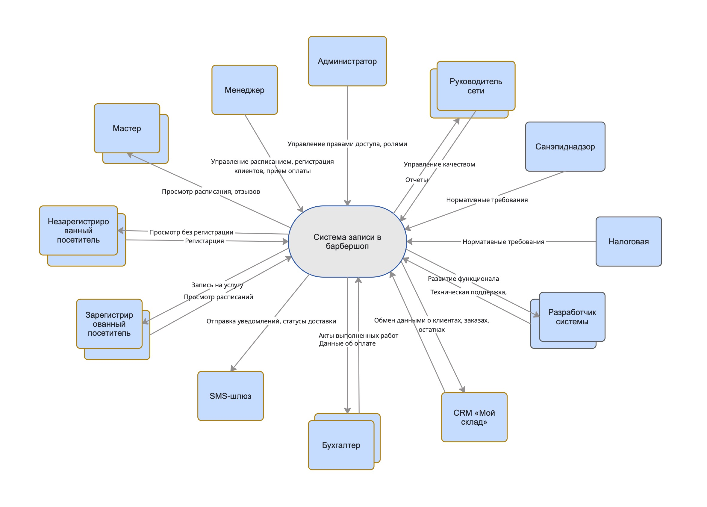
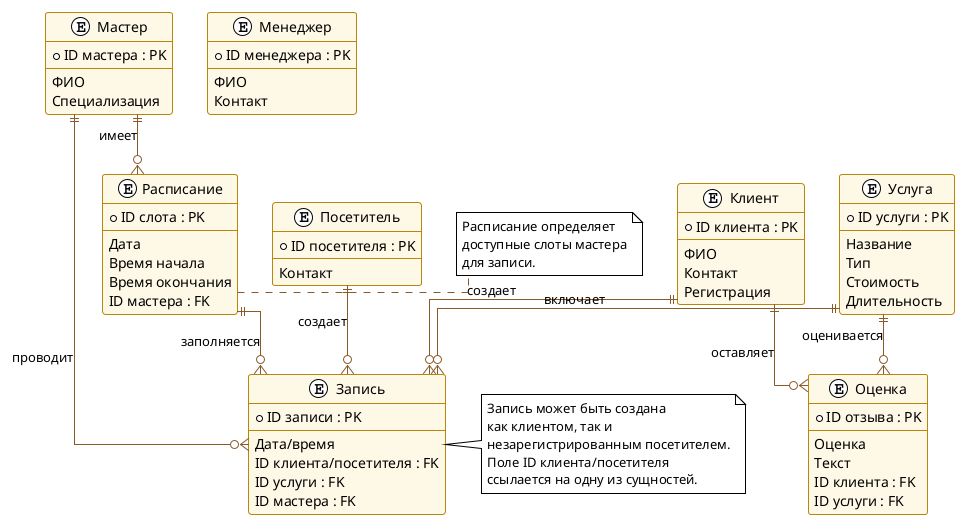

# БСА04_Предметная область и информационная модель

# 1. Предметная область

### 1.1 Определение

**Предметная область (domain)** — часть реального мира, рассматриваемая в некоторых пределах. Это обстоятельства и условия, которые:

- влияют на построение/изменение системы;
- находятся под влиянием построения/изменения системы;
- способствуют пониманию системы.

### 1.2 Что входит в предметную область

| Категория                           | Примеры                                                                 |
| -------------------------------------------- | ------------------------------------------------------------------------------ |
| Предметы реального мира | Мастер, Клиент, Услуга                                       |
| Потоки данных                    | Запись, Отзыв, Расписание                                 |
| Люди и организации           | Менеджер, Администратор, Санэпиднадзор       |
| Бизнес-процессы                | Запись на услугу, Учёт оплаты                          |
| Идеи и технологии             | Онлайн-запись, автоматические уведомления |
| Цели и задачи                     | Расширение клиентской базы                             |
| Связи                                   | Зависимость записи от расписания мастера   |

### 1.3 Контекст системы

Контекст — это система и её непосредственное окружение (внешние сущности, взаимодействующие с системой).

## 2. Выделение сущностей и действий над ними

### 2.1 Методика выделения сущностей

| Шаг                                           | Описание                                                                                             |
| ------------------------------------------------ | ------------------------------------------------------------------------------------------------------------ |
| 1. Выделение кандидатов       | Находим пары «существительное — глагол» в тексте задачи      |
| 2. Выделение сущностей         | Определяем объекты, события, над которыми работает система |
| 3. Определение атрибутов     | Выявляем уникальные свойства каждой сущности                         |
| 4. Определение связей           | Устанавливаем отношения (1:1, 1:M, M:M)                                                |
| 5. Сопоставление атрибутов | Распределяем атрибуты по сущностям                                            |
| 6. Назначение ключей             | Определяем первичные и внешние ключи                                         |
| 7. Проверка модели                 | Итерационное уточнение                                                                  |

### 2.2 Сущности предметной области (из задачи)

| Сущность                     | Назначение                                                                                                   | Ключевые атрибуты                                                                                   |
| ------------------------------------ | ---------------------------------------------------------------------------------------------------------------------- | ------------------------------------------------------------------------------------------------------------------- |
| **Клиент**               | Получатель услуг, может записаться на стрижку и оставить отзыв    | ID клиента, ФИО, Контакт, Зарегистрирован                                           |
| **Посетитель**       | Незарегистрированный пользователь, может записаться на услугу   | ID посетителя, Контакт                                                                             |
| **Услуга**               | Описывает тип и стоимость процедуры                                                     | ID услуги, Название, Тип, Стоимость, Длительность                             |
| **Мастер**               | Оказывает услуги, имеет расписание и может просматривать отзывы | ID мастера, ФИО, Специализация                                                               |
| **Менеджер**           | Управляет расписанием, связью с клиентами, отмечает оплату           | ID менеджера, ФИО, Контакт                                                                       |
| **Запись**               | Факт бронирования услуги клиентом или посетителем                          | ID записи, Дата и время, ID клиента/посетителя, ID услуги, ID мастера |
| **Расписание**       | Свободные слоты мастеров для записи                                                     | ID слота, ID мастера, Дата, Время начала, Время окончания                  |
| **Оценка и отзыв** | Отзывы клиентов об услуге после оказания                                            | ID отзыва, ID клиента, ID услуги, Текст, Оценка                                       |

---

## 3. Проверка сущностей по CRUD

**CRUD** — методика проверки полноты действий над сущностью:

- **C**reate (создание)
- **R**ead (чтение)
- **U**pdate (обновление)
- **D**elete (удаление)

### 3.1 Матрица CRUD для всех сущностей

| Сущность                     | CREATE                                                | READ                                                      | UPDATE                                                             | DELETE                                                           |
| ------------------------------------ | ----------------------------------------------------- | --------------------------------------------------------- | ------------------------------------------------------------------ | ---------------------------------------------------------------- |
| **Клиент**               | Клиент регистрируется             | Менеджер просматривает               | Клиент обновляет контакты                   | Менеджер архивирует                            |
| **Посетитель**       | Посетитель вводит контакт      | Менеджер просматривает               | —                                                                 | Система удаляет по истечении срока |
| **Услуга**               | Менеджер добавляет                   | Клиент, Мастер просматривают     | Менеджер обновляет                                | Менеджер переводит в архив                |
| **Мастер**               | Менеджер регистрирует             | Клиент, Менеджер просматривают | Менеджер обновляет                                | Менеджер архивирует                            |
| **Менеджер**           | Администратор назначает         | Администратор просматривает     | Администратор обновляет                      | Администратор удаляет доступ           |
| **Запись**               | Клиент, Посетитель оформляют | Мастер, Менеджер просматривают | Клиент, Менеджер переносят/отменяют | Менеджер удаляет ошибочную               |
| **Расписание**       | Менеджер вводит                         | Клиент, Мастер просматривают     | Менеджер редактирует                            | Менеджер удаляет/заменяет слот        |
| **Оценка и отзыв** | Клиент оставляет                       | Менеджер, Мастер просматривают | Клиент редактирует (в течение 24ч)       | Менеджер удаляет по жалобе                |

### 3.2 Примечания к CRUD

- **Архивирование вместо удаления:** Для сущностей с исторической ценностью (клиент, мастер, услуга, запись) используется мягкое удаление — перевод в архив
- **Гипотезы:** Срок хранения данных незарегистрированных посетителей и возможность редактирования отзыва требуют уточнения с заказчиком

---

## 4. Словарь данных

### 4.1 Определение

**Словарь данных (Data Dictionary)** — средство описания данных в бизнес-терминах, содержащее информацию о типах, форматах, ограничениях и политике безопасности.

### 4.2 Отличие от глоссария

| Характеристика | Глоссарий                                                           | Словарь данных                                                         |
| ---------------------------- | ---------------------------------------------------------------------------- | ----------------------------------------------------------------------------------- |
| Содержание         | Термины, понятия, бизнес-описание                | Бизнес-описание + технические характеристики |
| Состав                 | Атомарные понятия                                            | Может содержать составные элементы                   |
| Специфика           | Универсален для любой предметной области | Специфичен для ИТ-проектов                                   |

### 4.3 Словарь данных сущностей

| Сущность     | Мнемоника | Описание                                                  | Тип данных                        | Обязательность |
| -------------------- | ------------------ | ----------------------------------------------------------------- | ------------------------------------------ | ---------------------------- |
| Клиент         | client             | Зарегистрированный пользователь     | UUID, строка, телефон         | Да                         |
| Посетитель | visitor            | Незарегистрированный пользователь | UUID, строка                         | Нет                       |
| Услуга         | service            | Процедура, предлагаемая салоном       | UUID, строка, число             | Да                         |
| Мастер         | master             | Специалист, предоставляющий услуги | UUID, строка                         | Да                         |
| Менеджер     | manager            | Сотрудник, управляющий расписанием | UUID, строка                         | Да                         |
| Запись         | appointment        | Бронирование услуги                             | UUID, дата-время, ID ссылок | Да                         |
| Расписание | schedule           | Слоты доступности мастеров                | UUID, дата, время                 | Да                         |
| Отзыв           | feedback           | Мнение клиента после услуги               | UUID, текст, рейтинг           | Нет                       |

---

## 5. ER-диаграмма (PlantUML)

### 5.1 Концептуальная модель данных

### 5.2 Описание связей между сущностями

| Связь                           | Тип | Описание                                                                  |
| ------------------------------------ | ------ | --------------------------------------------------------------------------------- |
| Клиент → Запись         | 1:M    | Один клиент может создать много записей         |
| Посетитель → Запись | 1:M    | Один посетитель может создать много записей |
| Мастер → Расписание | 1:M    | Один мастер имеет много слотов в расписании  |
| Мастер → Запись         | 1:M    | Один мастер проводит много записей                  |
| Услуга → Запись         | 1:M    | Одна услуга может быть в многих записях          |
| Расписание → Запись | 1:M    | Один слот может быть заполнен одной записью  |
| Клиент → Отзыв           | 1:M    | Один клиент может оставить много отзывов       |
| Услуга → Отзыв           | 1:M    | Одна услуга может иметь много отзывов             |

---

## 6. Модели данных

### 6.1 Уровни моделей данных

| Уровень                         | Описание                                                                 | Кто разрабатывает       |
| -------------------------------------- | -------------------------------------------------------------------------------- | --------------------------------------- |
| **Концептуальная** | Основные сущности и связи, семантика домена | Аналитик                        |
| **Логическая**         | Сущности, атрибуты, ключи, бизнес-правила      | Аналитик + Архитектор |
| **Физическая**         | Таблицы, столбцы, индексы, СУБД                         | Разработчик                  |
