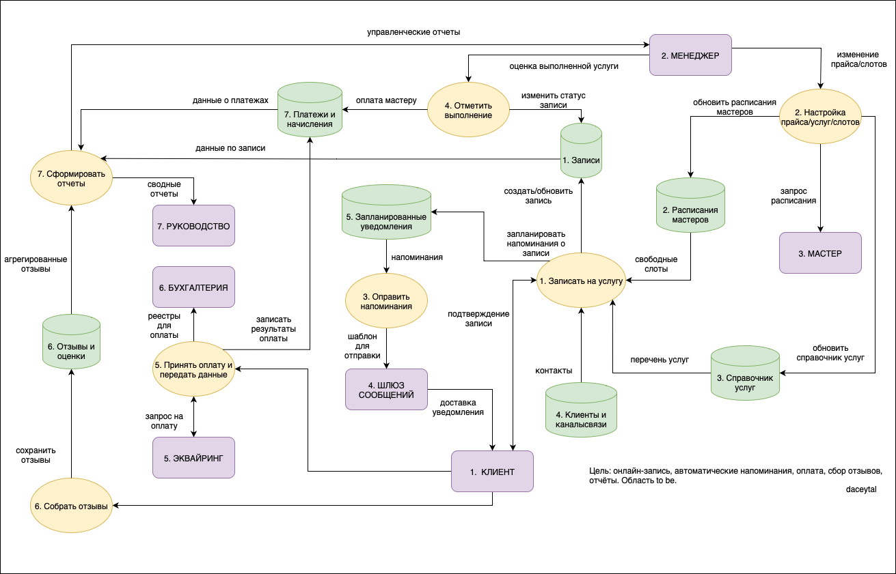
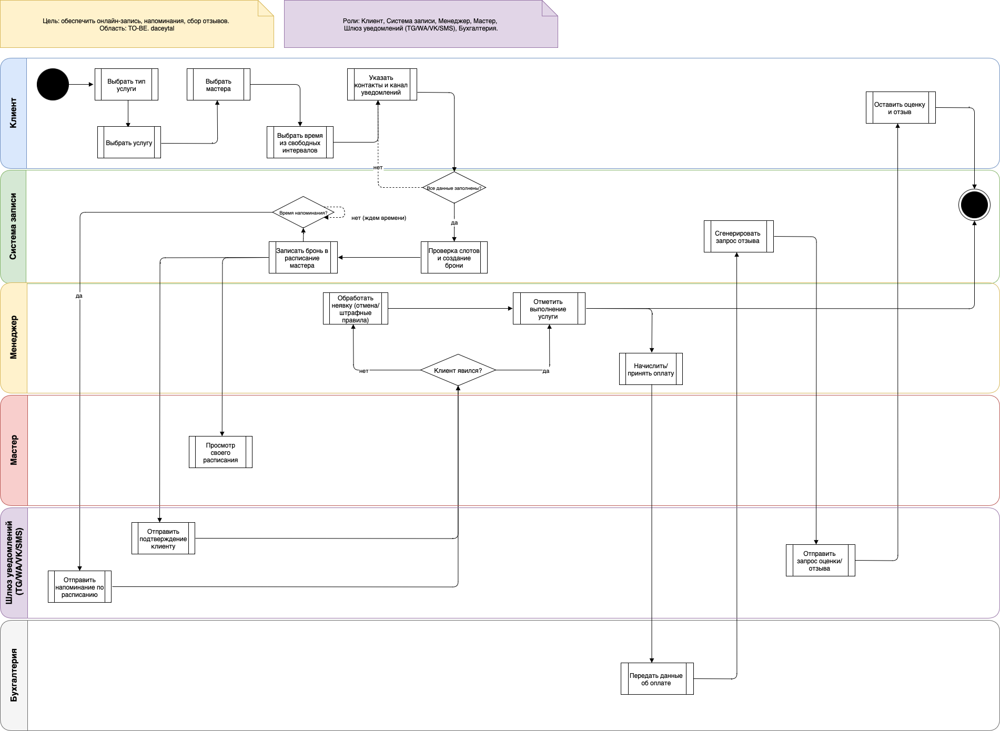
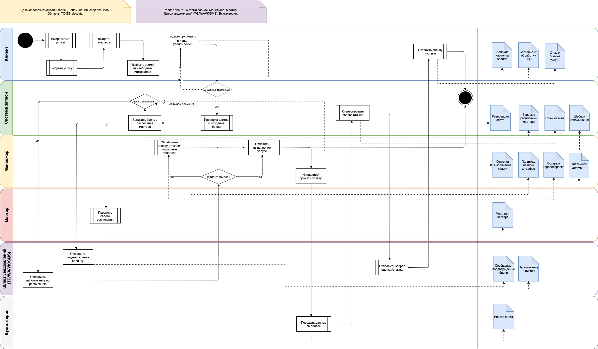
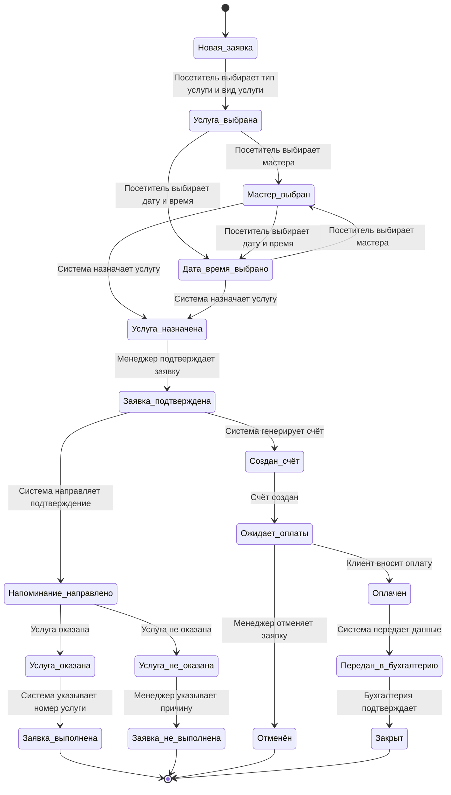

# БСА05_Модели и диаграммы

## 1. Модели и моделирование требований

### 1.1 Почему нужны разные модели?

> «Все модели неверны, но некоторые полезны» — Джордж Бокс

Представление требований в одном виде не дает их полной картины (Алан Девис). Необходимо использовать:

- **Текстовое описание** — текущее состояние и функциональные требования
- **Графическое представление** — диаграммы разных типов
- **Табличное представление** — состояния артефактов в зависимости от условий
- **Прототипы** — пользовательский интерфейс, отчеты

Каждое представление показывает требования в отдельном разрезе, а сопоставление разных представлений позволяет выявить несоответствия, пропуски и просчеты.

### 1.2 Что такое модель?

**Модель** — упрощенное описание действительности, позволяющее исследовать или обрабатывать объект, содержит существенные свойства моделируемого объекта.

### 1.3 Аспекты моделирования

| Артефакт                                          | Модели                                                                                | Компоненты (аспекты)                        |
| --------------------------------------------------------- | ------------------------------------------------------------------------------------------- | ------------------------------------------------------------ |
| Люди, организации, ИТ-системы     | Контекстная диаграмма, DFD                                              | Внешние системы, внешние объекты |
|                                                           | Диаграммы вариантов использования                            | Действующие лица                              |
|                                                           | Диаграммы «сущность-связь»                                          | Сущности, атрибуты                           |
|                                                           | Диаграмма swimlane                                                                 | Дорожки                                               |
| Объекты с состояниями                  | Диаграмма переходов состояний, таблица состояний | Объекты с состояниями                     |
| Передаваемые и хранимые данные | Контекстная диаграмма, DFD                                              | Потоки и хранилища данных              |
|                                                           | Диаграмма «сущность-связь»                                          | Сущности, атрибуты                           |
|                                                           | Диаграмма swimlane                                                                 | Дорожки                                               |

### 1.4 Принципы построения диаграмм

Перед построением диаграммы необходимо определить:

| Параметр                                  | Описание                                                                   |
| ------------------------------------------------- | ---------------------------------------------------------------------------------- |
| **Цель**                                | Для чего строится диаграмма                                |
| **Область рассмотрения** | AS IS (область проблем) или TO BE (область решений) |
| **Метод (вид диаграммы)**  | DFD, Swimlane, State Diagram и др.                                              |

**Важно:** Строгость применения нотаций определяется договоренностями в команде. Диаграмма для обсуждения с заказчиком может быть проще, чем для использования внутри команды.

---

## 2. Диаграмма потоков данных (DFD)

### 2.1 Определение

**Диаграмма потоков данных (Data Flow Diagram, DFD)** — дает представление о том, как данные движутся внутри системы и между системой и внешним миром, отражает хранилища и потоки данных и материалов (информации о материалах).

### 2.2 Уровни DFD

| Уровень                                      | Описание                                                                                                   |
| --------------------------------------------------- | ------------------------------------------------------------------------------------------------------------------ |
| **Контекстная диаграмма** | Система как «черный ящик», взаимодействие с внешней средой       |
| **DFD уровня 0**                        | Декомпозиция системы на основные процессы и потоки между ними |
| **DFD уровня 1 и глубже**        | Детализация отдельных процессов                                                       |

### 2.3 Элементы DFD

| Элемент                            | Обозначение                                                         | Описание                                                                        |
| ----------------------------------------- | ------------------------------------------------------------------------------ | --------------------------------------------------------------------------------------- |
| **Внешняя сущность** | Прямоугольник                                                     | Стейкхолдеры, инициаторы или получатели данных |
| **Процесс**                  | Овал/прямоугольник со скругленными углами | Преобразование входных потоков в выходные          |
| **Хранилище данных** | Открытый прямоугольник                                    | Место хранения данных                                                |
| **Поток данных**         | Стрелка с надписью                                             | Перемещение данных между элементами                     |

### 2.4 Правила проверки DFD

1. Все данные, которые входят в систему, должны для чего-то использоваться
2. Все данные, которые передаются системой наружу, должны откуда-то появиться
3. DFD должна коррелировать с каталогом заинтересованных сторон и луковичной диаграммой
4. Данные в DFD должны соответствовать словарю данных

### 2.5 Диаграмма потоков данных (из файла dfd.png)

Основные потоки данных:
• Запись на услугу → Клиент → Система
• Управление расписанием → Менеджер → Система
• Просмотр расписания → Система → Мастер
• Сбор отзывов → Система → Руководство
• Платежи и начисления → Система → Эквайринг → Оплата мастеру

---

## 3. Диаграмма «Плавательные дорожки» (Swimlane)

### 3.1 Определение

**Диаграмма swimlane (межфункциональная диаграмма)** — применяется для изучения и демонстрации бизнес-процессов, выполняемых пользователями и системой, взаимодействия пользователей между собой и отражения последовательности действий.

### 3.2 Структура диаграммы

| Элемент                              | Описание                                                                                       |
| ------------------------------------------- | ------------------------------------------------------------------------------------------------------ |
| **Дорожки (swimlanes)**        | Горизонтальные или вертикальные секции для каждой роли |
| **Действия**                  | Прямоугольники внутри дорожек                                               |
| **Потоки управления** | Стрелки между действиями                                                         |
| **Артефакты**                | Документы, объекты, создаваемые в процессе                         |

### 3.3 Что позволяет проверить Swimlane

- Полноту ролевой модели (роли и выполняемые действия)
- Взаимодействие с внешними системами
- Порядок выполнения действий
- Создаваемые и используемые артефакты

### 3.4 Диаграмма Swimlane (из файла swd.png)

### 3.5 Расширенная диаграмма с артефактами (из файла adswd.png)

---

## 4. Диаграмма состояний (State Diagram)

### 4.1 Определение

**Диаграмма состояний** — показывает поведение конкретного объекта (класса) в системе, изменение его состояний под влиянием событий.

### 4.2 Элементы диаграммы состояний

| Элемент                                  | Описание                                                                       |
| ----------------------------------------------- | -------------------------------------------------------------------------------------- |
| **Состояние**                    | Условие или ситуация в жизненном цикле объекта |
| **Начальное состояние** | Точка старта (черный круг)                                        |
| **Конечное состояние**   | Точка завершения (черный круг в окружности)        |
| **Переход**                        | Стрелка между состояниями с указанием события  |
| **Событие**                        | Действие, вызывающее переход                                  |
| **Условие**                        | Дополнительное условие перехода                           |

### 4.3 Диаграмма состояний:

### 4.4 Таблица состояний: Уведомление клиенту

| Текущее состояние                      | Событие                                    | Следующее состояние       | Условие                                                     |
| ------------------------------------------------------ | ------------------------------------------------- | ------------------------------------------- | ------------------------------------------------------------------ |
| **Новая заявка**                      | Выбор услуги                           | Услуга_выбрана                 | Услуга активна                                        |
| **Услуга выбрана**                  | Выбор мастера                         | Мастер_выбран                   | Мастер выполняет выбранную услугу    |
| **Услуга выбрана**                  | Выбор даты/времени                | Дата_время_выбрано          | Выбранный слот свободен                       |
| **Мастер выбран**                    | Выбор даты/времени                | Дата_время_выбрано          | Выбранный слот свободен                       |
| **Дата время выбрано**           | Система назначает услугу    | Услуга_назначена             | Нет конфликтов расписания                   |
| **Услуга назначена**              | Подтверждение менеджером   | Заявка_подтверждена       | Все данные корректны                             |
| **Заявка подтверждена**        | Генерация счета                     | Создан_счёт                       | —                                                                 |
| **Заявка подтверждена**        | Отправка подтверждения       | Напоминание_направлено | —                                                                 |
| **Создан счёт**                        | Счет создан                             | Ожидает_оплаты                 | —                                                                 |
| **Ожидает оплаты**                  | Оплата клиентом                     | Оплачен                              | Сумма оплачена полностью                     |
| **Ожидает оплаты**                  | Отмена менеджером                 | Отменён                              | Отмена до момента оплаты                      |
| **Оплачен**                               | Передача в бухгалтерию        | Передан_в_бухгалтерию    | —                                                                 |
| **Передан в бухгалтерию**     | Подтверждение бухгалтерии | Закрыт                                | Данные приняты, проведены в учете      |
| **Напоминание направлено** | Услуга оказана                       | Услуга_оказана                 | Отметка менеджера или мастера            |
| **Напоминание направлено**  | Услуга не оказана                  | Услуга_не_оказана            | Неявка клиента, отказ или форс-мажор |
| **Услуга оказана**                  | Указать номер услуги            | Заявка_выполнена             | —                                                                 |
| **Услуга не оказана**             | Указать причину                     | Заявка_не_выполнена        | —                                                                 |

---

### 4.5. Decision Table: Правила выбора слота

| Условие                | Слот свободен | Слот забронирован | Слот в прошлом | Результат                           |
| ----------------------------- | ------------------------- | --------------------------------- | -------------------------- | -------------------------------------------- |
| Клиент выбирает | ✅                        | ❌                                | ❌                         | Создать запись                  |
| Клиент выбирает | ❌                        | ✅                                | ❌                         | Предложить другое время |
| Клиент выбирает | ❌                        | ❌                                | ✅                         | Заблокировать выбор        |

---

## 5. Сравнение моделей

| Модель            | Что показывает                                                                    |  | Когда использовать                                                                  |
| ----------------------- | ---------------------------------------------------------------------------------------------- | - | ---------------------------------------------------------------------------------------------------- |
| **DFD**           | Движение данных, хранилища, внешние взаимодействия |  | Для понимания информационных потоков и границ системы |
| **Swimlane**      | Последовательность действий по ролям                          |  | Для анализа бизнес-процессов и взаимодействия ролей     |
| **State Diagram** | Жизненный цикл объекта, переходы между состояниями |  | Для объектов со сложной логикой изменения состояний     |
