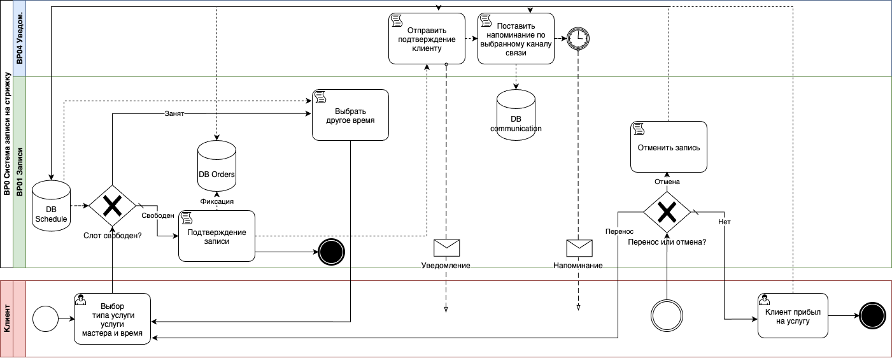
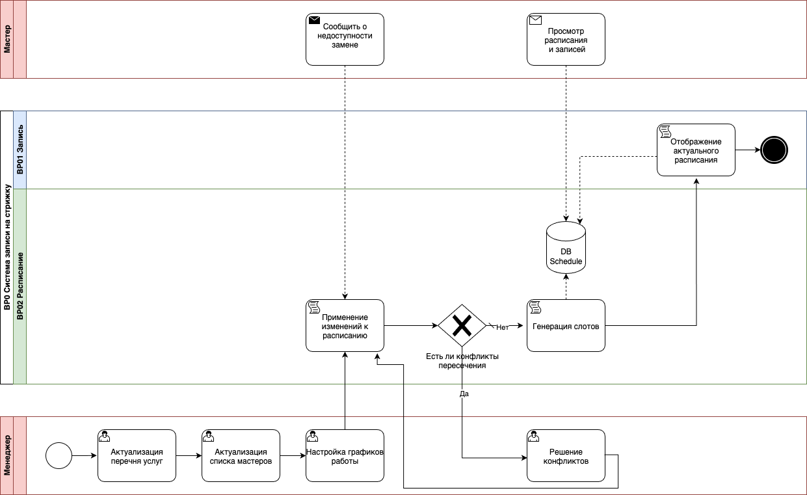
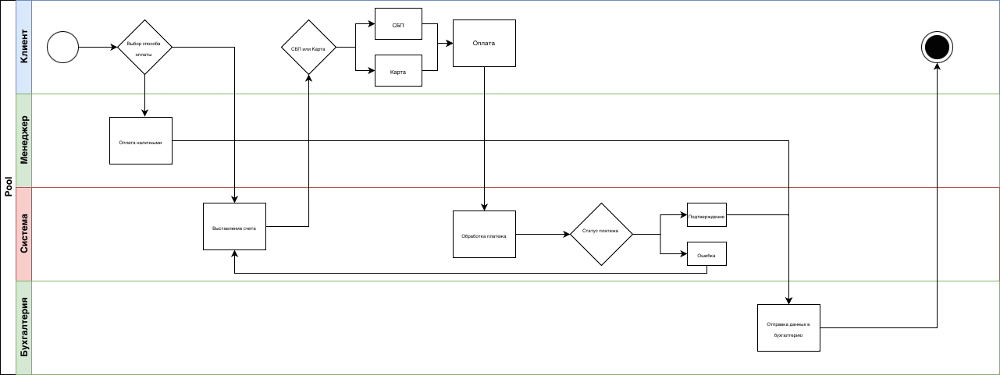
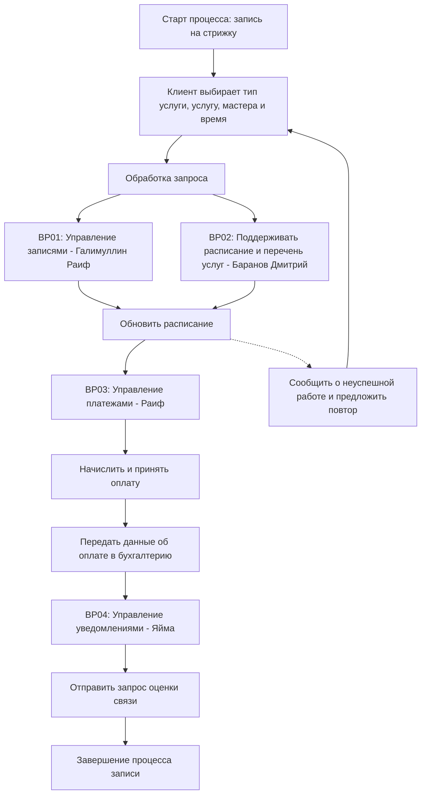

# БСА06_Моделирование бизнес-процессов

## 1. Бизнес-процессы: определение и элементы

### 1.1 Что такое бизнес-процесс?

**Бизнес-процесс** — последовательность действий (мероприятий, операций, работ), ограниченная началом и окончанием и направленная на получение заданного результата (создание продукта или услуги).

### 1.2 Основные элементы бизнес-процесса

| Элемент                                     | Описание                                                                    | Пример                                                                       |
| -------------------------------------------------- | ----------------------------------------------------------------------------------- | ---------------------------------------------------------------------------------- |
| **Цель/Результат (выход)** | То, ради чего выполняется процесс                       | Созданная запись клиента                                     |
| **Владелец процесса**        | Лицо, отвечающее за выполнение и результат      | Менеджер                                                                   |
| **Исполнители**                   | Люди, выполняющие действия                                   | Клиент, Менеджер, Мастер                                       |
| **Вход**                                 | Ресурсы, необходимые для создания результата | Запрос на запись, данные клиента                        |
| **Начало**                             | Событие, инициирующее процесс                             | Клиент выбирает услугу                                         |
| **Окончание**                       | Событие получения результата                              | Запись создана или отменена                                |
| **Применяемые ресурсы**    | Ресурсы, используемые без изменения                  | Справочник услуг, расписание мастеров             |
| **Шаги процесса**                | Действия в определенной последовательности   | Выбор услуги → выбор времени → подтверждение |

---

## 2. Процессный подход

**Процессный подход** — рассмотрение деятельности организации как системы взаимосвязанных и согласованных процессов, выполняемых для достижения главных целей.

### 2.1 Категории бизнес-процессов

| Категория                     | Описание                                                                                                | Примеры                                                                               |
| -------------------------------------- | --------------------------------------------------------------------------------------------------------------- | -------------------------------------------------------------------------------------------- |
| **Основные**             | Добавляют ценность бизнесу                                                              | Управление записями, Управление платежами               |
| **Обеспечивающие** | Поддерживают основные процессы, не приносят прямую ценность | Управление уведомлениями, Управление отчетностью |

### 2.2 Критерии выделения бизнес-процессов

- Различие в целях (разные потребности)
- Бизнес-процесс должен получать результат (выход)

### 2.3 Порядок работ

| Шаг | Описание                                                                                                                    |
| ------ | ----------------------------------------------------------------------------------------------------------------------------------- |
| 1      | Определить область: AS IS (проблемы) или TO BE (решения)                                         |
| 2      | Выполнить декомпозицию, выделить основные и обеспечивающие                      |
| 3      | Рассмотреть основные процессы (от важных к менее важным)                             |
| 4      | Рассмотреть обеспечивающие процессы (без которых основные не работают) |

### 2.4 Важные правила

- **Не выделять процессы по функциям ролей** — процессный подход показывает сквозные цепочки между ролями
- Бизнес-процессы должны обеспечивать:
  - Выполнение бизнес-требований
  - Решение проблем заинтересованных сторон
  - Выполнение функций ролей системы

---

## 3. Реестр бизнес-процессов

**Область:** TO BE

| Название бизнес-процесса                  | Идентификатор | Результат                                                                                              | Роль владельца | Владелец              | Тип процесса      |
| --------------------------------------------------------------- | -------------------------- | --------------------------------------------------------------------------------------------------------------- | --------------------------- | ----------------------------- | ---------------------------- |
| Управление записями клиентов          | BP01                       | Созданная/измененная/отмененная запись клиента на услугу      | Менеджер            | Галимуллин Раиф | Основной             |
| Управление расписанием и услугами | BP02                       | Актуальное расписание мастеров и перечень услуг                       | Менеджер            | Баранов Дмитрий | Основной             |
| Управление платежами                         | BP03                       | Обработанная оплата услуг и переданные данные в бухгалтерию | Менеджер            | Ахметова Энже     | Основной             |
| Управление уведомлениями                 | BP04                       | Отправленные уведомления и напоминания клиентам                      | Менеджер            | Галимуллин Раиф | Обеспечивающий |
| Управление отчетностью                     | BP05                       | Сформированные отчеты о выполненных услугах                              | Менеджер            | Баранов Дмитрий | Обеспечивающий |

---

## 4. BPMN-диаграммы

### 4.1 Что такое BPMN?

**BPMN (Business Process Model and Notation)** — интуитивно-понятный язык моделирования бизнес-процессов.

### 4.2 Типы диаграмм BPMN

| Тип                          | Описание                                                                                                 |
| ------------------------------- | ---------------------------------------------------------------------------------------------------------------- |
| **Process Diagram**       | Последовательность задач, событий, условия и логика процесса |
| **Collaboration Diagram** | Потоки сообщений между участниками                                                |
| **Choreography Diagram**  | Последовательность взаимодействий участников                           |
| **Conversation Diagram**  | Верхний уровень взаимодействия                                                       |

### 4.3 Базовые элементы BPMN

| Элемент                        | Обозначение                                                | Описание                                                              |
| ------------------------------------- | --------------------------------------------------------------------- | ----------------------------------------------------------------------------- |
| **Событие (Event)**      | Круг                                                              | Начало, промежуточное, окончание процесса |
| **Действие (Activity)** | Прямоугольник со скругленными углами | Задача, операция, работа                                  |
| **Шлюз (Gateway)**          | Ромб                                                              | Развилка, условие, ветвление                          |
| **Поток (Flow)**           | Стрелка                                                        | Последовательность выполнения                     |
| **Данные (Data)**         | Прямоугольник с изгибом                          | Документы, объекты данных                               |
| **Пул (Pool)**               | Прямоугольник с дорожками                      | Участник процесса (организация, система)    |
| **Дорожка (Swimlane)**   | Секция внутри пула                                    | Роль внутри участника                                      |

### 4.4 Виды процессов в BPMN

| Тип                               | Описание                                                                           |
| ------------------------------------ | ------------------------------------------------------------------------------------------ |
| **Исполняемые**     | Могут реально исполняться через ПО (Business Studio, Bizagi) |
| **Неисполняемые** | Для изучения, согласования и демонстрации              |

---

## 5. BPMN-диаграмма BP01: Управление записями клиентов

**Процесс:** Создание, изменение и отмена записей клиентов
**Область:** TO BE

---

## 6. BPMN-диаграмма BP02: Управление расписанием и услугами

**Процесс:** Поддержание актуального расписания мастеров и перечня услуг
**Область:** TO BE

---

## 7. BPMN-диаграмма BP03: Управление платежами

**Процесс:** Обработка оплаты услуг и передача данных в бухгалтерию
**Область:** TO BE

---

## 8. Сводная диаграмма процессов (Mermaid)

---

## 9. Глоссарий

### 9.1 Основные термины (BSA00)

| Термин                            | Трактовка                                                                                                                                                                                                                                                                                   |
| --------------------------------------- | ---------------------------------------------------------------------------------------------------------------------------------------------------------------------------------------------------------------------------------------------------------------------------------------------------- |
| **Мастер**                  | Профессионал, оказывающий косметологические и парикмахерские услуги. Имеет доступ к своему расписанию клиентов и отзывам.                                                                   |
| **Менеджер**              | Сотрудник, управляющий ключевыми функциями системы: обновляет расписания, обрабатывает платежи, контролирует выполнение услуг и анализирует отчётные данные. |
| **Онлайн-запись**     | Технология, позволяющая клиентам собственноручно выбирать и бронировать нужную услугу через веб-интерфейс или приложение без личного обращения к персоналу.   |
| **Напоминания**        | Система автоматических уведомлений, которая рассылает сообщения пользователю о приближающихся записях или необходимости оставить отзыв.                                      |
| **Оценка услуги**     | Цифровой индекс или комментарий, оставляемый клиентом после посещения. Показывает степень удовлетворённости и помогает улучшать сервис.                                        |
| **Клиентская база** | Информационный массив о посетителях: контактные данные, история обращений, записи и отзывы, используемые для анализа и персонального взаимодействия.                  |

### 9.2 Термины системы (BSA01)

| Термин                                | Трактовка                                                                                                                                                                                                                                                                                                                                    |
| ------------------------------------------- | ----------------------------------------------------------------------------------------------------------------------------------------------------------------------------------------------------------------------------------------------------------------------------------------------------------------------------------------------------- |
| **Личный кабинет**       | Персональный раздел веб-сайта или приложения, где пользователь может просматривать информацию о своих записях, историю посещений, управлять настройками и взаимодействовать с системой. |
| **Календарь записей** | Интерактивный интерфейс, отображающий расписание мастеров с возможностью выбора свободных временных слотов для бронирования.                                                                                                            |
| **Нотификация**            | Автоматическое уведомление, отправляемое пользователю при наступлении определенного события: подтверждение записи, напоминание, запрос отзыва и т.д.                                                                  |
| **Рейтинг мастера**     | Усреднённая оценка работы специалиста на основе отзывов клиентов, влияющая на его популярность и распределение записей в системе.                                                                                                      |
| **Конверсия записей** | Показатель эффективности системы, отражающий долю посетителей, которые перешли с этапа просмотра услуг на этап бронирования и реального посещения.                                                                      |

### 9.3 Термины предметной области (BSA02, BSA06)

| Термин                                     | Трактовка                                                                                                                                                                                                                                                      |
| ------------------------------------------------ | ----------------------------------------------------------------------------------------------------------------------------------------------------------------------------------------------------------------------------------------------------------------------- |
| **Расписание**                   | Периодически обновляемая таблица (календарь) работы мастеров, доступная менеджеру для внесения и корректировки                                                          |
| **CRM-система**                     | Программное обеспечение (например, «Мой склад») для управления взаимодействиями с клиентами, регистрации звонков и хранения данных о клиентах. |
| **Отметка о выполнении** | Статус услуги, проставляемый менеджером после фактического оказания сервиса клиенту.                                                                                                          |
| **Статус записи**              | Состояние забронированного слота в системе: «Ожидает», «Подтверждена», «Выполнена», «Отменена» или «Перенесена».                                                       |

---

## 10. Связь бизнес-процессов с требованиями

| Бизнес-процесс                                     | ID   | Связанные требования | Решаемые проблемы                                             |
| --------------------------------------------------------------- | ---- | --------------------------------------- | ----------------------------------------------------------------------------- |
| Управление записями клиентов          | BP01 | UR-02, FR-01, FR-02                     | Трудно записаться (дозвониться)                    |
| Управление расписанием и услугами | BP02 | UR-05, UR-12, FR-08                     | Ошибки в расписании, двойные бронирования |
| Управление платежами                         | BP03 | UR-08, FR-11                            | Ошибки в учёте данных                                       |
| Управление уведомлениями                 | BP04 | UR-03, FR-05, FR-06                     | Сложность ручных напоминаний                        |
| Управление отчетностью                     | BP05 | UR-10                                   | Отсутствие аналитики                                       |
