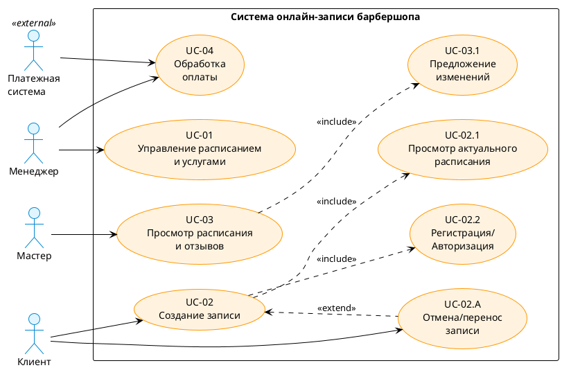

# БСА08_Сценарии использования (User Case)

# 1. Что такое варианты использования?

**Вариант использования (Use Case, UC)** — описание взаимодействия участников с системой для достижения определенной цели.

Главное в UC — не *что* человек делает, а *зачем* и *с какой целью*.

### 1.1 Формы представления

| Форма                                                                       | Описание                                         |
| -------------------------------------------------------------------------------- | -------------------------------------------------------- |
| **Повествовательное текстовое описание** | Свободный текст                            |
| **Структурированный текст**                          | Разделы по шаблону                       |
| **Таблица**                                                         | Форматированное описание          |
| **Диаграмма**                                                     | Схема вариантов использования |

### 1.2 Терминология

| Термин                                              | Описание                                                                                    |
| --------------------------------------------------------- | --------------------------------------------------------------------------------------------------- |
| **Сценарий использования**     | Описание одного кейса, одной ветки взаимодействия        |
| **Вариант использования**       | Совокупность сценариев при разных условиях                    |
| **Действующее лицо (Актор)**    | Внешний участник процесса (роль, группа лиц, система)    |
| **Главный актор**                       | Заинтересованная сторона, получающая бизнес-ценность |
| **Заинтересованная сторона** | Все, кто заинтересован во взаимодействии с системой     |

---

## 2. Структура описания UC

### 2.1 Основные разделы

| Раздел                                              | Описание                                                                          |
| --------------------------------------------------------- | ----------------------------------------------------------------------------------------- |
| **Заголовок**                              | Уникальное название (глагол + существительное)     |
| **Действующие лица**                 | Главный актор и другие заинтересованные стороны |
| **Цель (Назначение)**                 | Бизнес-потребность главного актора                         |
| **Область действия (Scope)**         | Черный ящик / Полупрозрачный / Прозрачный               |
| **Предусловия**                          | Условия, истинные перед выполнением UC                     |
| **Триггер**                                  | Событие, запускающее UC                                                 |
| **Постусловия (Гарантии)**       | Условия, истинные при завершении UC                           |
| **Поток событий**                       | Основной, альтернативные потоки, исключения         |
| **Дополнительные параметры** | Ссылки на UI, бизнес-правила, НФТ                                 |

### 2.2 Постусловия

| Тип                                            | Описание                                                                                         |
| ------------------------------------------------- | -------------------------------------------------------------------------------------------------------- |
| **Минимальные гарантии** | Условия, истинные при любом завершении (успешном или нет) |
| **Гарантии успеха**           | Условия успешного завершения UC                                                |

---

## 3. Потоки событий

### 3.1 Типы потоков

| Тип                                            | Описание                                                                  |
| ------------------------------------------------- | --------------------------------------------------------------------------------- |
| **Основной поток**             | Самый короткий/простой путь достижения цели |
| **Альтернативный поток** | Другие возможные пути (успешные или нет)         |
| **Поток исключений**         | Поведение, когда цель недостижима                    |

### 3.2 Рекомендации по описанию шагов

| Правило                                                                            | Пример                                                                               |
| ----------------------------------------------------------------------------------------- | ------------------------------------------------------------------------------------------ |
| Использовать простые предложения                            | «Система отображает список мастеров»                      |
| Указывать исполнителя действия                                | «Клиент выбирает услугу»                                             |
| Группировать данные одного направления                 | «Система получает ФИО и контактные данные»            |
| Использовать «подтверждает» вместо «проверяет» | «Система подтверждает наличие свободного слота» |
| Нумеровать шаги сквозной нумерацией                       | 1, 2, 3...                                                                                 |
| Альтернативные потоки привязывать к шагу              | 5.A.1, 5.A.2...                                                                            |

### 3.3 Четыре шага транзакции

1. Участник вводит запрос и передает данные
2. Система подтверждает данные
3. Система изменяет состояние
4. Система выдает результат

---

## 4. Связи между вариантами использования

### 4.1 Включение (Include)

Общая функциональность, используемая несколькими UC.

| Характеристика         | Описание                                              |
| ------------------------------------ | ------------------------------------------------------------- |
| **Обозначение**     | `<<include>>`                                               |
| **Смысл**                 | Базовый UC*включает* другой UC         |
| **Зависимость**     | Базовый UC зависит от включаемого  |
| **Инициирование** | Не инициируется напрямую актором |

### 4.2 Расширение (Extend)

Дополнительная функциональность, вставляемая в UC.

| Характеристика         | Описание                                                                         |
| ------------------------------------ | ---------------------------------------------------------------------------------------- |
| **Обозначение**     | `<<extend>>`                                                                           |
| **Смысл**                 | Другой UC*расширяет* базовый                                     |
| **Зависимость**     | Расширяющий UC зависит от базового                           |
| **Инициирование** | Может инициироваться при определенных условиях |

---

## 5. Диаграмма связей вариантов использования

## 6. Вариант использования: Управление расписанием (BP02_UC01)

**Источник:** ex00_CUT_UC.docx

### 6.1 Общая информация

| Поле                                                  | Значение                                                                                                                                                                                                                                 |
| --------------------------------------------------------- | ------------------------------------------------------------------------------------------------------------------------------------------------------------------------------------------------------------------------------------------------ |
| **Уникальный идентификатор** | BP02_UC01                                                                                                                                                                                                                                        |
| **Название**                                | Обновление расписания работы и профиля услуг мастера                                                                                                                                               |
| **Основной актор**                     | Менеджер                                                                                                                                                                                                                                 |
| **Цель**                                        | Сформировать и поддерживать в системе актуальные базовые данные: график работы мастера и закрепленный перечень оказываемых услуг |

### 6.2 Действующие лица

| Тип                                                    | Лицо         | Интерес/Потребность                                                                                                            |
| --------------------------------------------------------- | ---------------- | ------------------------------------------------------------------------------------------------------------------------------------------------ |
| **Главный актор**                       | Менеджер | Обеспечить корректное и актуальное расписание для формирования слотов записи |
| **Заинтересованная сторона** | Мастер     | Чтобы рабочее время и услуги были отражены точно                                                        |
| **Заинтересованная сторона** | Клиент     | Чтобы система показывала достоверный список мастеров и услуг                                |

### 6.3 Предусловия и постусловия

| Тип                                            | Описание                                                                                                                                                                                 |
| ------------------------------------------------- | ------------------------------------------------------------------------------------------------------------------------------------------------------------------------------------------------ |
| **Предусловия**                  | 1. Менеджер авторизован с правами на управление расписанием ` `2. Мастер заведен в системе как сотрудник |
| **Триггер**                          | Менеджер открывает раздел «Управление расписанием и услугами» и выбирает мастера                                          |
| **Минимальные гарантии** | Система зафиксировала факт взаимодействия и обеспечила базовую целостность                                                    |
| **Гарантии успеха**           | Базовое расписание и перечень услуг обновлены и являются основой для формирования слотов                            |

### 6.4 Предположения

- Не рассматривается формирование конкретных временных слотов и их публикация
- Не рассматривается управление выходными и отпусками мастера

---

## 7. Вариант использования: Управление расписанием (потоки)

**Источник:** ex01_CUT_UC.docx

### 7.1 Основной сценарий

| Шаг | Действие                                                                                                                                                                 |
| ------ | -------------------------------------------------------------------------------------------------------------------------------------------------------------------------------- |
| 1      | Менеджер открывает раздел управления расписанием и услугами                                                                 |
| 2      | Менеджер обновляет или подтверждает перечень доступных услуг (базовая стоимость, длительность) |
| 3      | Менеджер назначает каждому мастеру набор услуг                                                                                          |
| 4      | Менеджер настраивает или корректирует график работы мастера                                                                 |
| 5      | Менеджер запускает процесс генерации рабочих слотов                                                                                |
| 6      | Система генерирует свободные слоты расписания для бронирования                                                           |
| 7      | Система публикует актуальные слоты услуг для выбранного мастера                                                          |
| 8      | Система отображает подтверждение об успешном обновлении                                                                        |

### 7.2 Альтернативные сценарии

**A. На шаге 5-6: Система обнаруживает конфликт (наложение смен)**

| Шаг                           | Действие                                                                                     |
| -------------------------------- | ---------------------------------------------------------------------------------------------------- |
| 5.A.1                            | Система выводит сообщение о конфликте в расписании       |
| 5.A.2                            | Менеджер вносит корректировки в график работы мастера |
| *Возврат к шагу 5* |                                                                                                      |

**B. На шаге 2: Мастер предлагает изменения в своем графике**

| Шаг                           | Действие                                                                                                                |
| -------------------------------- | ------------------------------------------------------------------------------------------------------------------------------- |
| 2.B.1                            | Система отображает предложение об изменении от мастера                          |
| 2.B.2                            | Менеджер рассматривает предложение и подтверждает или отклоняет его |
| 2.B.3                            | При подтверждении система вносит изменения в график работы мастера    |
| *Возврат к шагу 4* |                                                                                                                                 |

---

## 8. Вариант использования: Создание записи (UC-02)

**Источник:** ex02_CUT_UC.docx, ex03_CUT_UC.docx

### 8.1 Общая информация

| Поле                                                  | Значение                                                                                                    |
| --------------------------------------------------------- | ------------------------------------------------------------------------------------------------------------------- |
| **Уникальный идентификатор** | UC-02                                                                                                               |
| **Название**                                | Создание записи на услугу                                                                     |
| **Основной актор**                     | Клиент                                                                                                        |
| **Триггер**                                  | Клиент нажимает кнопку «Записаться онлайн»                                    |
| **Цель**                                        | Выбрать услугу, мастера, свободный слот и зафиксировать запись |

### 8.2 Связи

| Связь | Тип          | Вариант использования                                 | Цель связи                                                                  |
| ---------- | --------------- | ------------------------------------------------------------------------- | ------------------------------------------------------------------------------------ |
|            | `<<include>>` | UC-02.1. Просмотр актуального расписания     | Получить данные о свободных слотах из BP02           |
|            | `<<include>>` | UC-02.2. Регистрация/Авторизация клиента     | Идентифицировать клиента для создания записи |
|            | `<<extend>>`  | UC-02.A. Отмена или перенос записи клиентом | Обеспечить изменение брони после создания       |

### 8.3 Основной сценарий

| Шаг | Действие                                                                                                                  |
| ------ | --------------------------------------------------------------------------------------------------------------------------------- |
| 1      | Клиент открывает сайт/приложение барбершопа                                                |
| 2      | Клиент выбирает тип услуги (например, «Парикмахерские»)                            |
| 3      | Клиент выбирает конкретную услугу из списка                                                 |
| 4      | Система отображает список мастеров, выполняющих выбранную услугу         |
| 5      | Клиент выбирает мастера                                                                                      |
| 6      | **Включается UC-02.1. Просмотр актуального расписания**                              |
| 6.1    | Система отображает календарь с доступными датами                                       |
| 6.2    | Клиент выбирает дату                                                                                            |
| 6.3    | Система отображает свободные слоты времени мастера                                   |
| 7      | Клиент выбирает удобный свободный слот времени                                           |
| 8      | **Включается UC-02.2. Регистрация/Авторизация клиента**                              |
| 9      | Система отображает сводку по записи (услуга, мастер, время, цена)             |
| 10     | Клиент подтверждает создание записи                                                               |
| 11     | Система создает запись в статусе «Подтверждена» и резервирует слот      |
| 12     | Система отображает клиенту подтверждение с уникальным номером записи |
| 13     | Система инициирует BP04 (Управление уведомлениями)                                        |

### 8.4 Альтернативные сценарии

**A. На шаге 6.3: Нет свободных слотов на желаемую дату/время**

| Шаг                                                          | Действие                                                                                                    |
| --------------------------------------------------------------- | ------------------------------------------------------------------------------------------------------------------- |
| 6.A.1                                                           | Система сообщает об отсутствии свободных слотов                           |
| 6.A.2                                                           | Клиент выбирает другую дату, другого мастера или другую услугу |
| *Возврат к соответствующему шагу* |                                                                                                                     |

**B. На шаге 10: Клиент отменяет бронирование**

| Шаг                                | Действие                                                                                                      |
| ------------------------------------- | --------------------------------------------------------------------------------------------------------------------- |
| 10.B.1                                | Клиент отказывается от подтверждения                                                 |
| 10.B.2                                | Система отменяет процесс бронирования, слот остается свободным |
| *Сценарий завершен* |                                                                                                                       |

**C. После успешного завершения: Клиент хочет отменить или перенести запись**
*Расширяется UC-02.A. Отмена или перенос записи клиентом*

---

## 9. Вариант использования: Просмотр расписания мастером (UC-03)

**Источник:** ex04_CUT_UC.docx, ex05_CUT_UC.docx

### 9.1 Общая информация

| Поле                                                  | Значение                                                                                                                                                 |
| --------------------------------------------------------- | ---------------------------------------------------------------------------------------------------------------------------------------------------------------- |
| **Уникальный идентификатор** | UC-03                                                                                                                                                            |
| **Название**                                | Просмотр личного расписания и записей                                                                                           |
| **Основной актор**                     | Мастер                                                                                                                                                     |
| **Цель**                                        | Получить информацию о своих забронированных записях и ознакомиться с историей отзывов |

### 9.2 Связи

| Связь | Тип          | Вариант использования                                  | Цель связи                                                                       |
| ---------- | --------------- | -------------------------------------------------------------------------- | ----------------------------------------------------------------------------------------- |
|            | `<<include>>` | UC-03.1. Предложение изменений в расписании | Направить менеджеру запрос на изменение графика |

### 9.3 Основной сценарий

| Шаг | Действие                                                                                                                                                                         |
| ------ | ---------------------------------------------------------------------------------------------------------------------------------------------------------------------------------------- |
| 1      | Мастер входит в свой личный кабинет в системе                                                                                                      |
| 2      | Система отображает панель управления мастера                                                                                                     |
| 3      | Мастер выбирает раздел «Мое расписание»                                                                                                               |
| 4      | Система отображает календарный вид с рабочими сменами и забронированными слотами на текущую неделю |
| 5      | Мастер выбирает конкретную дату или смену                                                                                                            |
| 6      | Система отображает детализированный список записей (время, клиент, услуга, статус)                                  |
| 7      | Мастер выбирает конкретную предстоящую запись                                                                                                   |
| 8      | Система отображает детали записи (имя, телефон, услуга, длительность, цена, пожелания)                             |
| 9      | Мастер возвращается к списку записей                                                                                                                     |
| 10     | Мастер переходит в раздел «История и отзывы»                                                                                                       |
| 11     | Система отображает список выполненных услуг с оценками и отзывами                                                               |

### 9.4 Альтернативные сценарии

**A. На шаге 4-5: Мастер хочет внести предложение по изменению графика**

| Шаг                           | Действие                                                                                                              |
| -------------------------------- | ----------------------------------------------------------------------------------------------------------------------------- |
| 5.A.1                            | Мастер нажимает кнопку «Предложить изменение графика»                         |
| 5.A.2                            | **Включается UC-03.1. Предложение изменений в расписании**                     |
| 5.A.3                            | Мастер указывает тип изменения (отгул, перенос смены), дату и причину |
| 5.A.4                            | Система отправляет запрос менеджеру на рассмотрение                             |
| *Возврат к шагу 4* |                                                                                                                               |

**B. На шаге 6: Записей очень много**

| Шаг | Действие                                                                                                                                                |
| ------ | --------------------------------------------------------------------------------------------------------------------------------------------------------------- |
| 6.B.1  | Мастер применяет фильтры (например, «Только на сегодня», «Только определенная услуга») |
| 6.B.2  | Система обновляет список записей согласно фильтрам                                                                 |

---

## 10. Сводная таблица вариантов использования

| UC ID     | Название                                                                      | Основной актор | Связанные BP | Include          | Extend  |
| --------- | ------------------------------------------------------------------------------------- | --------------------------- | --------------------- | ---------------- | ------- |
| BP02_UC01 | Обновление расписания и профиля услуг мастера | Менеджер            | BP02                  | —               | —      |
| UC-01     | Управление расписанием и услугами                       | Менеджер            | BP02                  | —               | —      |
| UC-02     | Создание записи на услугу                                       | Клиент                | BP01                  | UC-02.1, UC-02.2 | UC-02.A |
| UC-02.1   | Просмотр актуального расписания                          | Система              | BP02                  | —               | —      |
| UC-02.2   | Регистрация/Авторизация клиента                          | Клиент                | —                    | —               | —      |
| UC-02.A   | Отмена или перенос записи клиентом                      | Клиент                | BP01                  | —               | —      |
| UC-03     | Просмотр личного расписания и записей                | Мастер                | BP01, BP02, BP05      | UC-03.1          | —      |
| UC-03.1   | Предложение изменений в расписании                     | Мастер                | BP02                  | —               | —      |
