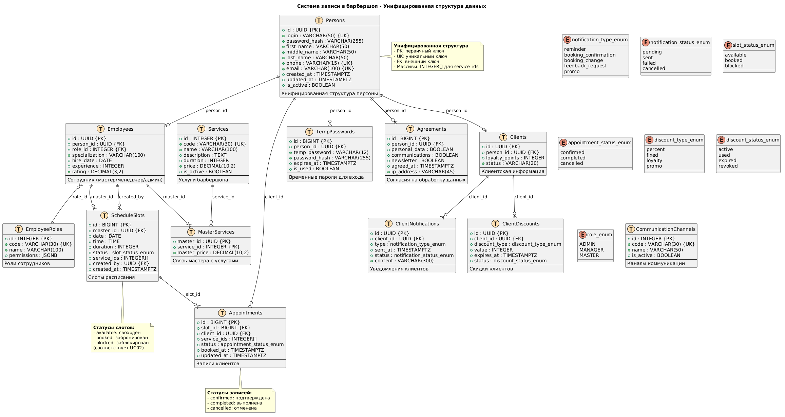

# БСА09_База данных и словарь данных

# Сущности и объекты системы

## 1. Жизненный цикл сущности

Действия, указанные в пользовательских историях и бизнес-процессах, — это действия над конкретной записью сущности, выполняемые пользователями в той или иной роли.

Для отслеживания состояний объекта применяют понятие **«жизненный цикл объекта»** — ряд состояний (статусов), которые проходит экземпляр объекта под влиянием действий или при определенных условиях.

Для отслеживания состояния в сущность добавляют атрибут **«Статус»**, определяющий состояние конкретного экземпляра.

---

## 2. Справочники

Справочники — сущности, содержащие данные, используемые для заполнения в других сущностях.

| Тип                                      | Описание                                                                                            | Пример                                      |
| ------------------------------------------- | ----------------------------------------------------------------------------------------------------------- | ------------------------------------------------- |
| **Справочник**              | Содержит неизменяемые или редко изменяемые данные               | Услуги, Сотрудники, Роли      |
| **Основная сущность** | Содержит изменяемые данные, связанные с бизнес-процессами | Слоты обслуживания, Записи |

**Принцип:** В основной сущности указывается внешний ключ на справочник, а не полное значение (например, `service_id` вместо названия услуги).

**Порядок разработки:**

1. Сначала разрабатываются справочники, не зависящие от других сущностей
2. Затем — справочники, использующие другие справочники
3. Затем — основные сущности

---

## 3. Описание объекта

Полное описание объекта должно содержать:

| Компонент                              | Описание                                                                                        |
| ----------------------------------------------- | ------------------------------------------------------------------------------------------------------- |
| **Назначение**                  | Целевое назначение сущности, участие в бизнес-процессах |
| **Атрибуты**                      | Поля с описанием, типами, обязательностью                            |
| **Связи**                            | ER-диаграмма или диаграмма классов                                          |
| **Действия (операции)**   | CRUD-операции над экземплярами                                                   |
| **Роли и права доступа** | Кто имеет право выполнять какие действия                             |
| **Жизненный цикл**           | Статусы и условия их изменения                                                |
| **Визуализация**              | Пользовательские интерфейсы                                                   |
| **Интерфейсы обмена**     | Интеграция с другими системами                                               |
| **Отчеты**                          | Мониторинг и аналитика                                                              |

---

## 4. Атрибуты объекта

Атрибут объекта — это поле (реквизит), содержащее определенное свойство объекта.

### 4.1 Описание атрибута

| Поле                                           | Описание                                                 | Пример                                        |
| -------------------------------------------------- | ---------------------------------------------------------------- | --------------------------------------------------- |
| **Наименование**                 | Название атрибута на русском языке | Идентификатор персоны           |
| **Мнемоника**                       | Имя для идентификации в ПО                 | `person_id`                                       |
| **Ключ**                                 | Тип ключа (PRIMARY, FOREIGN, UNIQUE)                     | `PRIMARY`                                         |
| **Тип данных**                      | Тип в СУБД                                               | `UUID`, `VARCHAR`                               |
| **Длина / формат**                | Максимальная длина или формат          | `20 символов`                             |
| **Обязательность**             | Обязательное / Необязательное          | `Обязательное`                        |
| **Значение по умолчанию** | Значение при создании                         | `DEFAULT gen_random_uuid()`                       |
| **Комментарии**                   | Пояснения, условия                               | `Уникальный идентификатор` |

### 4.2 Правила

- Не добавлять атрибуты «на всякий случай»
- Мнемоника — наиболее устойчивый идентификатор (даже название может измениться)
- Блоки атрибутов выделяются как отдельные сущности, связанные с исходной

---

## 5. Диаграмма классов

**Диаграмма классов (Class Diagram)** — структурная диаграмма UML, демонстрирующая:

- Иерархию классов системы
- Атрибуты (поля) и методы
- Взаимосвязи между классами

### 5.1 Структура класса на диаграмме

```

┌─────────────────────────────┐
│         Имя класса          │  ← Верхняя часть (заглавная буква)
├─────────────────────────────┤
│ - атрибут1: тип             │  ← Средняя часть (поля)
│ - атрибут2: тип             │
├─────────────────────────────┤
│ + метод1(): возврат         │  ← Нижняя часть (методы)
│ + метод2(): возврат         │
└─────────────────────────────┘

```

### 5.2 Принципы выделения классов

| Принцип                                           | Описание                                                                                                |
| -------------------------------------------------------- | --------------------------------------------------------------------------------------------------------------- |
| **Обобщение**                             | Выделять классы, а не конкретные объекты                                      |
| **Существительные**                 | Выделять из описания задачи пары «существительное — глагол» |
| **Минимализм**                           | Не создавать лишние сущности без необходимости                         |
| **Ориентация на требования** | Моделировать аспекты, содержащиеся в требованиях                     |

---

## 6. Сущности системы

### 6.1 Сущность «Персона» (Person)

**Источник:** ex00.xlsx

**Назначение:** Хранит базовые данные о всех пользователях системы (клиентах и сотрудниках).

| Наименование                  | Мнемоника | Ключ | Тип данных | Обязательность | Комментарии                          |
| ----------------------------------------- | ------------------ | -------- | ------------------- | ---------------------------- | ----------------------------------------------- |
| Идентификатор персоны | id                 | PRIMARY  | uuid                | Обязательное     | Уникальный идентификатор |
| Логин для входа              | login              |          | VARCHAR(20)         | Обязательное     | Регистрационные данные     |
| Хешированный пароль     | password_hash      |          | VARCHAR(255)        | Обязательное     | -                                               |
| Имя                                    | name               |          | VARCHAR(20)         | Обязательное     | Для обращений                       |
| Отчество                          | middle_name        |          | VARCHAR(50)         | Необязательное | -                                               |
| Номер телефона               | phone              |          | VARCHAR(11)         | Обязательное     | Для сообщений и созвонов   |
| Дата регистрации           | created_at         |          | TIMESTAMPTZ         | Обязательное     | `DEFAULT NOW()`                               |

---

### 6.2 Сущность «Клиент» (Client)

**Источник:** ex01.xlsx, ex04.png, ex06.png

**Назначение:** Хранит данные о зарегистрированных клиентах, расширяет сущность «Персона».

| Наименование                  | Мнемоника | Ключ | Тип данных | Обязательность | Комментарии                          |
| ----------------------------------------- | ------------------ | -------- | ------------------- | ---------------------------- | ----------------------------------------------- |
| Идентификатор записи   | id                 | PRIMARY  | UUID                | Обязательное     | Уникальный идентификатор |
| Идентификатор персоны | person_id          | FOREIGN  | UUID                | Обязательное     | Ссылка на Person                        |
| Уровень лояльности       | loyalty_points     |          | INTEGER             | Необязательное | Баллы лояльности                 |
| Статус клиента               | status             |          | VARCHAR(20)         | Необязательное | Статус клиента                     |
| Дата регистрации           | created_at         |          | TIMESTAMPTZ         | Обязательное     | `DEFAULT NOW()`                               |

---

### 6.3 Сущность «Сотрудник» (Employee)

**Источник:** ex01.xlsx, ex04.png, ex06.png

**Назначение:** Хранит данные о сотрудниках (мастерах, менеджерах), расширяет сущность «Персона».

| Наименование                  | Мнемоника | Ключ | Тип данных | Обязательность | Комментарии                            |
| ----------------------------------------- | ------------------ | -------- | ------------------- | ---------------------------- | ------------------------------------------------- |
| Идентификатор записи   | id                 | PRIMARY  | UUID                | Обязательное     | Уникальный идентификатор   |
| Идентификатор персоны | person_id          | FOREIGN  | UUID                | Обязательное     | Ссылка на Person                          |
| Дата найма                       | hire_date          |          | DATE                | Обязательное     | `DEFAULT NOW()`                                 |
| Статус работника           | status             |          | VARCHAR(20)         | Необязательное | работает, уволен, в отпуске |

---

### 6.4 Сущность «Роли сотрудника» (EmployeeRole)

**Источник:** ex02.xlsx

**Назначение:** Хранит принадлежность сотрудника к одной или нескольким ролям (мастер, менеджер). Используется для регулирования прав доступа.

| Наименование                | Мнемоника | Ключ | Тип данных | Обязательность | Комментарии        |
| --------------------------------------- | ------------------ | -------- | ------------------- | ---------------------------- | ----------------------------- |
| Идентификатор записи | id                 | PRIMARY  | uuid                | Обязательное     | `DEFAULT gen_random_uuid()` |
| Сотрудник                      | employee_id        | FOREIGN  | uuid                | Обязательное     | FK → employees.id            |
| Роль (реализация)         | role               |          | role_enum           | Обязательное     | `master` или `manager` |
| Активность                    | is_active          |          | boolean             | Обязательное     | `DEFAULT true`              |
| Время создания             | created_at         |          | timestamptz         | Обязательное     | `DEFAULT now()`             |

**Тип role_enum:** `master`, `manager`

---

### 6.5 Сущность «Услуги» (Service)

**Источник:** ex02.xlsx, ex04.png, ex06.png

**Назначение:** Содержит список услуг, доступных для записи в барбершопе. Используется при бронировании, отображении прайса и в отчётах.

| Наименование                | Мнемоника | Ключ | Тип данных | Обязательность | Комментарии                            |
| --------------------------------------- | ------------------ | -------- | ------------------- | ---------------------------- | ------------------------------------------------- |
| Идентификатор записи | id                 | PRIMARY  | uuid                | Обязательное     | `DEFAULT gen_random_uuid()`                     |
| Название услуги           | name               |          | varchar(50)         | Обязательное     | Отображаемое наименование |
| Код услуги                     | code               |          | varchar(20)         | Необязательное | Короткий машинный код          |
| Описание                        | description        |          | text                | Необязательное | Подробное описание               |
| Активность                    | is_active          |          | boolean             | Обязательное     | `DEFAULT true`                                  |
| Время создания             | created_at         |          | timestamptz         | Обязательное     | `DEFAULT now()`                                 |

---

### 6.6 Сущность «Услуги мастера» (EmployeeService)

**Источник:** ex02.xlsx, ex04.png, ex06.png

**Назначение:** Хранит соответствие между мастерами и услугами, которые они оказывают. Используется при подборе доступных услуг при записи.

| Наименование                | Мнемоника | Ключ | Тип данных | Обязательность | Комментарии                            |
| --------------------------------------- | ------------------ | -------- | ------------------- | ---------------------------- | ------------------------------------------------- |
| Идентификатор записи | id                 | PRIMARY  | uuid                | Обязательное     | `DEFAULT gen_random_uuid()`                     |
| Мастер                            | employee_id        | FOREIGN  | uuid                | Обязательное     | FK → employees.id                                |
| Услуга                            | service_id         | FOREIGN  | uuid                | Обязательное     | FK → services.id                                 |
| Активность                    | is_active          |          | boolean             | Обязательное     | `DEFAULT true`                                  |
| Длительность (мин)       | duration_minutes   |          | integer             | Необязательное | Своя длительность                 |
| Цена (копейки)               | price_cents        |          | integer             | Необязательное | Цена у мастера                        |
| Приоритет                      | sort_order         |          | integer             | Необязательное | `DEFAULT 100`                                   |
| Примечание                    | note               |          | varchar(255)        | Необязательное | Дополнительная информация |
| Время создания             | created_at         |          | timestamptz         | Обязательное     | `DEFAULT now()`                                 |

---

### 6.7 Сущность «Слот обслуживания» (ServiceSlot)

**Источник:** ex03.xlsx, ex04.png, ex06.png

**Назначение:** Хранит информацию о конкретном слоте записи: дата, время, мастер, клиент, услуга и статус. Применяется для отображения расписания и управления записями.

| Наименование              | Мнемоника | Ключ | Тип данных | Обязательность | Комментарии        |
| ------------------------------------- | ------------------ | -------- | ------------------- | ---------------------------- | ----------------------------- |
| Идентификатор слота | id                 | PRIMARY  | uuid                | Обязательное     | `DEFAULT gen_random_uuid()` |
| Дата слота                   | date               |          | date                | Обязательное     | YYYY-MM-DD                    |
| Время начала               | start_time         |          | time                | Обязательное     | HH:MM:SS                      |
| Мастер                          | employee_id        | FOREIGN  | uuid                | Обязательное     | FK → employees.id            |
| Клиент                          | client_id          | FOREIGN  | uuid                | Обязательное     | FK → clients.id              |
| Услуга                          | service_id         | FOREIGN  | uuid                | Обязательное     | FK → services.id             |
| Статус слота               | status             |          | slot_status_enum    | Обязательное     | `DEFAULT 'booked'`          |
| Время создания           | created_at         |          | timestamptz         | Обязательное     | `DEFAULT now()`             |

**Тип slot_status_enum:**

- `booked` — забронирован
- `confirmed` — подтверждён
- `cancelled` — отменён
- `completed` — успешно завершён
- `no_show` — неявка клиента
- `in_progress` — в работе

---

### 6.8 Сущность «Скидки клиенту» (ClientDiscount)

**Источник:** ex05.xlsx, ex06.png

**Назначение:** Хранит персональные и временные скидки, доступные конкретному клиенту.

| Наименование                | Мнемоника | Ключ | Тип данных  | Обязательность | Комментарии        |
| --------------------------------------- | ------------------ | -------- | -------------------- | ---------------------------- | ----------------------------- |
| Идентификатор скидки | id                 | PRIMARY  | uuid                 | Обязательное     | `DEFAULT gen_random_uuid()` |
| Клиент                            | client_id          | FOREIGN  | uuid                 | Обязательное     | FK → clients.id              |
| Вид скидки                     | discount_type      |          | discount_type_enum   | Обязательное     | Тип скидки           |
| Значение                        | value              |          | integer              | Обязательное     | `DEFAULT 0`                 |
| Дата истечения             | expires_at         |          | timestamptz          | Необязательное | NULL — бессрочно    |
| Статус                            | status             |          | discount_status_enum | Обязательное     | `DEFAULT 'active'`          |

**Тип discount_type_enum:**

- `percent` — процентная
- `fixed` — фиксированная сумма
- `loyalty` — баллы лояльности
- `promo` — промокод

**Тип discount_status_enum:**

- `active` — активна
- `used` — использована
- `expired` — истекла
- `revoked` — отозвана

---

### 6.9 Сущность «Извещение клиента» (ClientNotification)

**Источник:** ex05.xlsx, ex06.png

**Назначение:** Хранит напоминания и уведомления, предназначенные клиенту. Применяется для отправки напоминаний о записи и логирования коммуникаций.

| Наименование                      | Мнемоника | Ключ | Тип данных      | Обязательность | Комментарии                         |
| --------------------------------------------- | ------------------ | -------- | ------------------------ | ---------------------------- | ---------------------------------------------- |
| Идентификатор извещения | id                 | PRIMARY  | uuid                     | Обязательное     | `DEFAULT gen_random_uuid()`                  |
| Клиент                                  | client_id          | FOREIGN  | uuid                     | Обязательное     | FK → clients.id                               |
| Тип извещения                     | type               |          | notification_type_enum   | Обязательное     | Тип уведомления                  |
| Содержимое                          | content            |          | varchar(300)             | Обязательное     | Текст уведомления              |
| Время отправки                   | sent_at            |          | timestamptz              | Необязательное | Заполняется при отправке |
| Статус отправки                 | status             |          | notification_status_enum | Обязательное     | `DEFAULT 'pending'`                          |

**Тип notification_type_enum:**

- `reminder` — напоминание
- `booking_confirm` — подтверждение брони
- `booking_change` — изменение брони
- `feedback_request` — запрос отзыва
- `promo` — промо-акция

**Тип notification_status_enum:**

- `pending` — ожидает отправки
- `sent` — отправлено
- `failed` — ошибка отправки
- `cancelled` — отменено

---

## 7. Диаграмма классов (общая)



---

## 8. Связи между сущностями

| Связь                   | Тип | Описание                                                                                |
| ---------------------------- | ------ | ----------------------------------------------------------------------------------------------- |
| Person → Client             | 1:0..1 | Одна персона может быть клиентом                                    |
| Person → Employee           | 1:0..1 | Одна персона может быть сотрудником                              |
| Client → ServiceSlot        | 1:M    | Один клиент может иметь много слотов                             |
| Employee → ServiceSlot      | 1:M    | Один сотрудник может иметь много слотов                       |
| Service → ServiceSlot       | 1:M    | Одна услуга может быть во многих слотах                        |
| Employee → EmployeeService  | 1:M    | Один сотрудник может выполнять много услуг                 |
| Service → EmployeeService   | 1:M    | Одна услуга может выполняться многими сотрудниками |
| Client → ClientDiscount     | 1:M    | Один клиент может иметь много скидок                             |
| Client → ClientNotification | 1:M    | Один клиент может получать много уведомлений             |
| Employee → EmployeeRole     | 1:M    | Один сотрудник может иметь много ролей                         |
