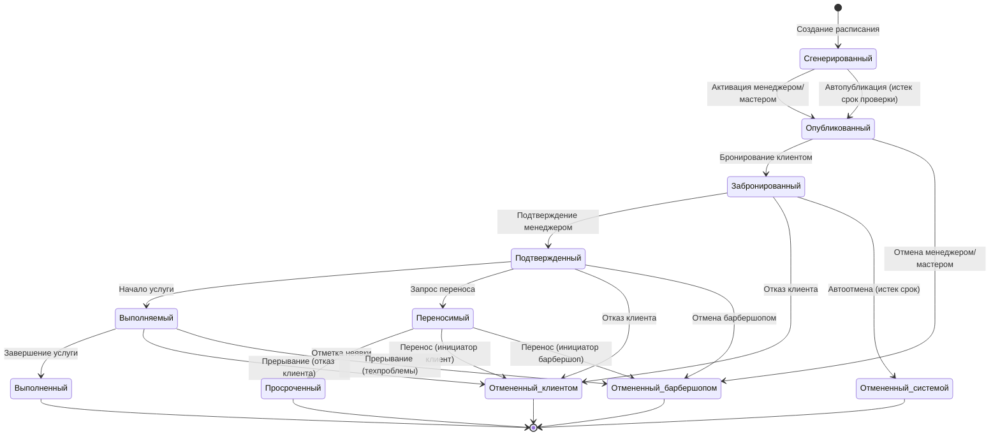

# БСА10_Проектирование функциональных требований

## 1. Операции над объектом

При рассмотрении операций над объектом следует описать:

| Операция | Описание                                                                                 |
| ---------------- | ------------------------------------------------------------------------------------------------ |
| **CREATE** | Создание новой записи                                                         |
| **READ**   | Чтение записи, использование в списках/справочниках |
| **UPDATE** | Редактирование существующей записи                               |
| **DELETE** | Удаление записи или запрет удаления                               |

### 1.1 Дополнительные параметры операций

| Параметр                                          | Описание                                                      |
| --------------------------------------------------------- | --------------------------------------------------------------------- |
| **Форма визуализации**             | Список и/или карточка объекта                |
| **Подтверждение выполнения** | Диалог подтверждения перед операцией |
| **Откат операции**                     | Возможность отмены операции                  |
| **Сортировка/Фильтр/Поиск**    | Способы работы со списками                     |
| **Логирование**                          | Сохранение истории изменений                |
| **Извещение**                              | Отправка сообщений при операции           |
| **Порождающие изменения**       | Влияние на другие части системы            |

---

## 2. Особенности операций

### 2.1 Удаление и редактирование

Операции удаления/редактирования требуют осторожности, так как могут повлиять на связанные данные.

**Варианты решения:**

- Добавление признака «Архив» — запись не используется для новых операций, но сохраняется в истории
- Указание дат начала и окончания актуальности записи

### 2.2 Каскадные воздействия

При изменении справочных данных необходимо учитывать влияние на связанные сущности.

| Изменение                  | Воздействие                                                                             |
| ----------------------------------- | -------------------------------------------------------------------------------------------------- |
| Увольнение мастера | Отмена/перенос будущих записей, уведомление клиентов |
| Деактивация услуги | Скрытие из выбора, обработка существующих записей       |
| Изменение цены         | Пересчет в новых записях, уведомление клиентов             |

---

## 3. Жизненный цикл сущности

Некоторые объекты проходят сложный жизненный путь. Для их описания применяют **статусную модель** — ряд состояний (статусов), которые проходит экземпляр объекта.

### 3.1 Форматы описания

| Формат                                    | Преимущества                                                                |
| ----------------------------------------------- | --------------------------------------------------------------------------------------- |
| **Диаграмма состояний** | Визуальная наглядность, легко увидеть переходы |
| **Таблица состояний**     | Детальное описание условий и инициаторов            |
| **Текстовое описание**   | Для простых случаев                                                    |

### 3.2 Структура таблицы состояний

| Элемент                                         | Описание                                                    |
| ------------------------------------------------------ | ------------------------------------------------------------------- |
| **Состояние до события**       | Исходное состояние объекта                  |
| **Инициатор**                           | Роль или система, вызывающая событие |
| **Действие / Событие**            | Что происходит                                         |
| **Условия / Правило**              | При каких условиях возможен переход  |
| **Состояние после события** | Новое состояние объекта                        |

---

## 4. Ролевая модель и права доступа

### 4.1 Матрица прав доступа (CRUD)

Для каждой роли определяется возможность выполнения операций над объектами:

| Роль                   | CREATE                   | READ                        | UPDATE                   | DELETE                       | Условия доступа   |
| -------------------------- | ------------------------ | --------------------------- | ------------------------ | ---------------------------- | ------------------------------- |
| Клиент               | Только свои    | Только свои       | Только свои    | Нет                       | Активный статус   |
| Менеджер           | Да (по задаче) | Все                      | Да (по задаче) | Нет (архив)          | Для обслуживания |
| Мастер               | Нет                   | Свои/связанные | Свои статусы  | Нет                       | Для работы             |
| Администратор | Да                     | Все                      | Да                     | Да (с условиями) | Полный доступ       |

---

## 5. Жизненный цикл объекта «Слот обслуживания»

### 5.1 Диаграмма состояний

### 5.2 Таблица состояний слота обслуживания

| Состояние до события | Инициатор            | Действие / Событие     | Условия / Правило                | Состояние после события     |
| -------------------------------------- | ----------------------------- | ------------------------------------- | ---------------------------------------------- | ------------------------------------------------ |
| Нет состояния              | Система                | Создание расписания | Автогенерация по шаблону | Сгенерированный                   |
| Сгенерированный         | Менеджер/Мастер | Активация слота         | Слот проверен                      | Опубликованный                     |
| Сгенерированный         | Система                | Автопубликация          | Истек срок проверки           | Опубликованный                     |
| Опубликованный           | Клиент                  | Бронирование              | Слот свободен                      | Забронированный                   |
| Опубликованный           | Менеджер              | Ручная отмена             | Изменение графика              | Отмененный барбершопом      |
| Забронированный         | Менеджер              | Подтверждение брони | Проверка данных                  | Подтвержденный                     |
| Забронированный         | Клиент                  | Отказ от брони            | До подтверждения                | Отмененный клиентом            |
| Забронированный         | Система                | Автоотмена                  | Истек срок подтверждения | Отмененный системой            |
| Подтвержденный           | Мастер                  | Начало услуги             | Клиент прибыл                      | Выполняемый                           |
| Подтвержденный           | Клиент                  | Запрос переноса         | Согласование времени        | Переносимый                           |
| Подтвержденный           | Менеджер              | Инициация переноса   | Причина барбершопа            | Переносимый                           |
| Подтвержденный           | Клиент                  | Отказ от услуги          | До начала                              | Отмененный клиентом            |
| Подтвержденный           | Менеджер              | Отмена услуги             | Форс-мажор                            | Отмененный барбершопом      |
| Переносимый                 | Система                | Завершение переноса | Создан новый слот               | Отмененный (по инициатору) |
| Выполняемый                 | Мастер                  | Завершение услуги     | Услуга оказана                    | Выполненный                           |
| Выполняемый                 | Мастер                  | Прерывание услуги     | Отказ/техпроблемы              | Отмененный (по причине)       |

---

## 6. Жизненные циклы других сущностей

### 6.1 Жизненный цикл «Клиент»

| Начало ЖЦ                                                                   | Завершение ЖЦ                                                                |
| ----------------------------------------------------------------------------------- | ---------------------------------------------------------------------------------------- |
| Регистрация (самостоятельная или менеджером) | Архивация (окончательное хранение без удаления) |

| Статус                   | Исходное состояние             | Инициатор            | Действие                    | Следующее состояние           |
| ------------------------------ | ----------------------------------------------- | ----------------------------- | ----------------------------------- | ----------------------------------------------- |
| Регистрируемый   | Нет состояния                       | Клиент/Менеджер | Ввод данных               | Активный                                |
| Активный               | Регистрируемый                    | Система                | Активация аккаунта | Заблокированный/Архивный |
| Заблокированный | Активный                                | Менеджер              | Блокировка доступа | Активный/Архивный               |
| Архивный               | Активный/Заблокированный | Система                | Перенос в архив        | (конец ЖЦ)                               |

### 6.2 Жизненный цикл «Сотрудник» (мастер/менеджер)

| Начало ЖЦ            | Завершение ЖЦ                                    |
| ---------------------------- | ------------------------------------------------------------ |
| Прием на работу | Перевод в архив после увольнения |

| Статус                            | Исходное состояние                      | Инициатор | Действие                                         | Следующее состояние                      |
| --------------------------------------- | -------------------------------------------------------- | ------------------ | -------------------------------------------------------- | ---------------------------------------------------------- |
| Принимаемый                  | Нет состояния                                | HR                 | Оформление документов                | Активный                                           |
| Активный                        | Принимаемый                                   | HR                 | Включение в расписание               | Временно недоступный/Уволенный |
| Временно недоступный | Активный                                         | Менеджер   | Приостановка генерации слотов | Активный/Уволенный                        |
| Уволенный                      | Активный/Временно недоступный | HR                 | Отключение доступа                      | Архивный                                           |
| Архивный                        | Уволенный                                       | Система     | Перенос в архив                             | (конец ЖЦ)                                          |

### 6.3 Жизненный цикл «Услуга»

| Начало ЖЦ                            | Завершение ЖЦ                                                     |
| -------------------------------------------- | ----------------------------------------------------------------------------- |
| Разработка новой услуги | Перевод в архив (более не предоставляется) |

| Статус                   | Исходное состояние | Инициатор | Действие                            | Следующее состояние |
| ------------------------------ | ----------------------------------- | ------------------ | ------------------------------------------- | ------------------------------------- |
| Разрабатываемая | Нет состояния           | Менеджер   | Определение параметров | Актуальная                  |
| Актуальная           | Разрабатываемая      | Менеджер   | Ввод в прайс                      | Неактуальная              |
| Неактуальная       | Актуальная                | Менеджер   | Исключение из прайса      | (конец ЖЦ)                     |

### 6.4 Жизненный цикл «Заказ» (запись клиента)

| Начало ЖЦ                                             | Завершение ЖЦ                                            |
| ------------------------------------------------------------- | -------------------------------------------------------------------- |
| Создание записи при бронировании | Закрытие после выполнения или отмены |

| Статус                                | Исходное состояние             | Инициатор            | Действие                        | Следующее состояние                              |
| ------------------------------------------- | ----------------------------------------------- | ----------------------------- | --------------------------------------- | ------------------------------------------------------------------ |
| Созданный                          | Нет состояния                       | Клиент/Менеджер | Бронирование слота     | Подтвержденный/Отмененный клиентом |
| Подтвержденный                | Созданный                              | Менеджер              | Подтверждение записи | Выполненный/Перенесенный                    |
| Выполняемый                      | Подтвержденный                    | Мастер                  | Начало услуги               | Выполняемый                                             |
| Выполненный                      | Выполняемый                          | Мастер                  | Завершение услуги       | Закрытый                                                   |
| Перенесенный                    | Подтвержденный                    | Клиент/Менеджер | Запрос переноса           | Закрытый                                                   |
| Отмененный клиентом       | Созданный/Подтвержденный | Клиент                  | Отказ от услуги            | Закрытый                                                   |
| Отмененный барбершопом | Созданный/Подтвержденный | Менеджер              | Отмена по инициативе  | Закрытый                                                   |
| Закрытый                            | Выполненный/Отмененный     | Система                | Завершение обработки | (конец ЖЦ)                                                  |

### 6.5 Жизненный цикл «Платеж»

| Статус                                | Исходное состояние                    | Инициатор                             | Действие                      | Следующее состояние       |
| ------------------------------------------- | ------------------------------------------------------ | ---------------------------------------------- | ------------------------------------- | ------------------------------------------- |
| Созданный                          | Нет состояния                              | Система                                 | Формирование счета   | Ожидающий оплаты             |
| Ожидающий оплаты             | Созданный                                     | Клиент                                   | Получение счета         | Успешный/Отклоненный     |
| Оплаченный                        | Ожидающий оплаты                        | Клиент/Платежная система | Оплата                          | Возврат инициированный |
| Отклоненный                      | Ожидающий оплаты                        | Платежная система              | Ошибка оплаты             | Отмененный                        |
| Отмененный                        | Ожидающий оплаты/Отклоненный | Менеджер                               | Отмена счета               | (конец ЖЦ)                           |
| Возврат инициированный | Оплаченный                                   | Менеджер/Клиент                  | Инициация возврата   | Возврат выполненный       |
| Возврат выполненный       | Возврат инициированный            | Бухгалтерия                         | Выполнение возврата | (конец ЖЦ)                           |

---

## 7. Операции над объектами (CRUD с детализацией)

### 7.1 Справочник «Клиент»

| Действие                  | Роль                      | UC   | Условия выполнения                | Подтверждение        | Порождающие изменения                 | Извещение                          |
| --------------------------------- | ----------------------------- | ---- | -------------------------------------------------- | --------------------------------- | --------------------------------------------------------- | ------------------------------------------- |
| Создание                  | Клиент                  | UC01 | Телефон не зарегистрирован | Пароль + СМС код      | Создание учетной записи              | СМС с данными входа         |
| Создание                  | Менеджер              | UC04 | Клиент предоставил данные   | Подпись менеджера | Запись в лог менеджера                 | СМС с временным паролем |
| Чтение                      | Клиент                  | -    | Активный статус                      | -                                 | -                                                         | -                                           |
| Чтение                      | Менеджер/Мастер | UC03 | Для своих задач                       | -                                 | -                                                         | -                                           |
| Редактирование      | Клиент                  | -    | Свои данные                              | Сохранение              | Обновление в связанных записях | -                                           |
| Редактирование      | Менеджер              | -    | Клиент обратился                    | Подпись + причина   | Может влиять на историю               | Уведомление клиенту       |
| Изменение статуса | Менеджер              | -    | Нарушение правил                    | Предупреждение      | Блокировка записей                       | Уведомление клиенту       |
| Удаление                  | Админ                    | -    | Нет активных записей             | Подтверждение        | Каскадное удаление связей          | Отчет менеджеру               |

### 7.2 Справочник «Услуги»

| Действие                  | Роль         | Условия выполнения                            | Подтверждение                      | Порождающие изменения     | Извещение                                    |
| --------------------------------- | ---------------- | -------------------------------------------------------------- | ----------------------------------------------- | --------------------------------------------- | ----------------------------------------------------- |
| Создание                  | Менеджер | Уникальный код, утвержденная цена | Подтверждение цены             | Добавление в прайс-лист   | Мастерам о новой услуге           |
| Чтение                      | Все           | Актуальный статус                              | -                                               | -                                             | -                                                     |
| Редактирование      | Менеджер | Можно менять описание, цену             | Для изменения цены              | Пересчет в новых записях | Клиентам при ↑цены >10%               |
| Изменение статуса | Менеджер | Услуга снята с предоставления        | Предупреждение о записях  | Скрытие из выбора              | Клиентам с будущими записями |
| Удаление                  | Админ       | Неактуальна >1 год                               | Подтверждение статистики | Физическое удаление         | Бухгалтерии                                |

### 7.3 Справочник «Услуги мастера»

| Действие                  | Роль                      | Условия выполнения                    | Подтверждение                | Порождающие изменения         | Извещение                                    |
| --------------------------------- | ----------------------------- | ------------------------------------------------------ | ----------------------------------------- | ------------------------------------------------- | ----------------------------------------------------- |
| Создание                  | Менеджер              | Мастер обучен, услуга активна | Подтверждение мастера | Добавление в расписание      | Мастеру о новой услуге             |
| Редактирование      | Менеджер              | Изменение цены/длительности   | При изменении цены        | Пересчет в будущих записях | Клиентам с будущими записями |
| Изменение статуса | Менеджер/Мастер | Временная недоступность          | Причина и срок                | Исключение из расписания    | Клиентам с записями                  |
| Прекращение            | Менеджер              | Мастер больше не оказывает      | Подтверждение мастера | Отмена/перенос записей        | Клиентам с будущими записями |

### 7.4 Таблица каскадных воздействий

| Справочник        | При изменении | Воздействие на связанные сущности              | Бизнес-правило                                                   |
| --------------------------- | ------------------------- | ---------------------------------------------------------------------------- | ----------------------------------------------------------------------------- |
| Клиент                | Архивация        | Записи клиента сохраняются с пометкой       | История услуг сохраняется для отчетности  |
| Сотрудник          | Увольнение      | Будущие слоты: отмена/перенос                       | Клиенты получают уведомление о замене        |
| Услуга                | Неактуальна    | Услуги мастера: становятся неактуальными | Существующие записи по старой цене              |
| Услуга мастера | Прекращена      | Будущие записи: отмена/перенос                     | Клиент получает компенсацию/альтернативу |

---

## 8. Операции над слотом обслуживания (детализация)

### 8.1 Матрица операций

| Операция                       | Роль                      | Условия выполнения      | Форма визуализации                    | Извещение                                  |
| -------------------------------------- | ----------------------------- | ---------------------------------------- | ------------------------------------------------------ | --------------------------------------------------- |
| C: Создание слотов       | Менеджер              | Заданы графики работы | Форма создания + предпросмотр | Уведомление менеджеру           |
| C: Автосоздание            | Система                | Настроен шаблон            | Лог системы + отчет                     | Отчет менеджеру на email            |
| R: Свободные слоты       | Клиент                  | Клиент активен              | Календарь/сетка                          | -                                                   |
| R: Расписание                | Мастер                  | Слоты закреплены          | Календарь дня/недели                 | -                                                   |
| R: Все слоты                   | Менеджер              | Полный доступ                | Таблица + карточка                      | -                                                   |
| U: Публикация                | Менеджер              | Слоты с будущей датой  | Список + массовый выбор             | -                                                   |
| U: Бронирование            | Клиент                  | Слот свободен                | Карточка слота                            | СМС/мессенджер                         |
| U: Подтверждение          | Менеджер              | Данные проверены          | Список забронированных            | СМС: подтверждение                  |
| U: Начало услуги           | Мастер                  | Время наступило            | Карточка записи                          | -                                                   |
| U: Завершение услуги   | Мастер                  | Услуга оказана              | Карточка текущей услуги           | Запрос отзыва                           |
| U: Перенос                      | Клиент/Менеджер | Найден новый слот         | Две панели (старый+новый)          | Уведомление о новом времени |
| U: Отмена клиентом       | Клиент                  | До начала ≥ N часов        | Карточка записи                          | Подтверждение отмены             |
| U: Отмена барбершопом | Менеджер              | Причина + компенсация  | Форма с причиной                         | Извинения + альтернативы       |
| U: Автоотмена                | Система                | Истек срок                      | Лог автоотмен                              | Уведомление клиенту               |
| D: Удаление слота         | Админ                    | Прошлый, без записей    | Список кандидатов                      | Уведомление админу                 |

---

## 9. Права доступа ролей к объектам

### 9.1 Доступ к объекту «Клиенты»

| Роль                   | CREATE                             | READ                                                    | UPDATE                                                  | DELETE                                                       | Условия доступа               |
| -------------------------- | ---------------------------------- | ------------------------------------------------------- | ------------------------------------------------------- | ------------------------------------------------------------ | ------------------------------------------- |
| Клиент               | Только свою запись | Только свою запись                      | Только свои контактные данные | Только если нет активных записей | Активный статус               |
| Менеджер           | Да (регистрация)      | Все клиенты                                   | Любые данные (кроме истории)     | Нет (только архив)                             | Для обслуживания             |
| Мастер               | Нет                             | Только своих текущих клиентов | Нет                                                  | Нет                                                       | Для подготовки к услуге |
| Администратор | Да                               | Все (включая архивных)                | Все данные и статусы                   | Да, архивных >1 года                           | Для администрирования   |

### 9.2 Доступ к объекту «Сотрудники»

| Роль                   | CREATE | READ                                            | UPDATE                                             | DELETE                           | Условия доступа                      |
| -------------------------- | ------ | ----------------------------------------------- | -------------------------------------------------- | -------------------------------- | -------------------------------------------------- |
| Клиент               | Нет | Только имена и фото             | Нет                                             | Нет                           | Для выбора при записи            |
| Менеджер           | Нет | Все мастера                           | Только статус «недоступен» | Нет                           | Для управления расписанием |
| Мастер               | Нет | Свои данные + имена коллег | Свои контактные данные         | Нет                           | Для личного кабинета             |
| Администратор | Да   | Все (включая уволенных)      | Все данные                                | Да, архивных >3 лет | Для HR                                          |

### 9.3 Доступ к объекту «Услуги»

| Роль                   | CREATE | READ                              | UPDATE                     | DELETE                                         | Условия доступа              |
| -------------------------- | ------ | --------------------------------- | -------------------------- | ---------------------------------------------- | ------------------------------------------ |
| Клиент               | Нет | Только актуальные | Нет                     | Нет                                         | Для выбора при записи    |
| Менеджер           | Да   | Все                            | Цену, описание | Нет (только неактуальные) | Для управления прайсом |
| Мастер               | Нет | Все услуги               | Нет                     | Нет                                         | Для ознакомления            |
| Администратор | Да   | Все                            | Все атрибуты    | Да, неактуальных >1 года     | Для полного управления |

### 9.4 Доступ к объекту «Слот обслуживания»

| Роль                   | CREATE | READ                             | UPDATE                                                        | DELETE                                  | Условия доступа           |
| -------------------------- | ------ | -------------------------------- | ------------------------------------------------------------- | --------------------------------------- | --------------------------------------- |
| Клиент               | Нет | Свободные + свои    | Бронь, отмена, перенос                      | Нет                                  | По статусам и времени |
| Менеджер           | Да   | Все слоты                | Все операции                                       | Нет                                  | Полный контроль           |
| Мастер               | Нет | Только свои слоты | Статус «выполняется»→«выполнен» | Нет                                  | Только в день услуги   |
| Администратор | Да   | Все                           | Все атрибуты                                       | Да, ошибочных прошлых | Для коррекции ошибок  |

---
