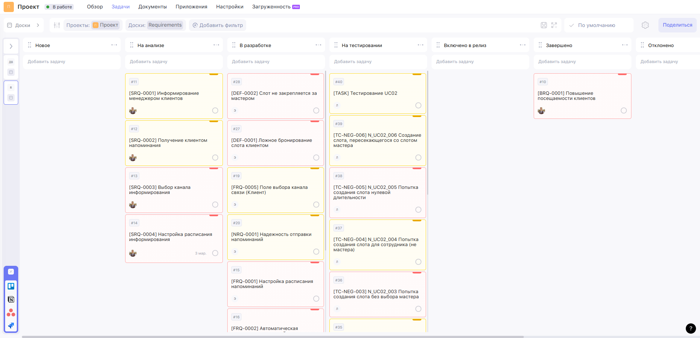
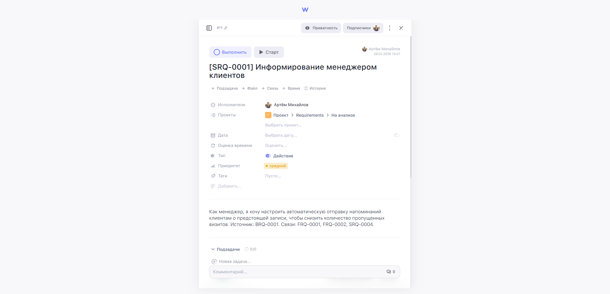
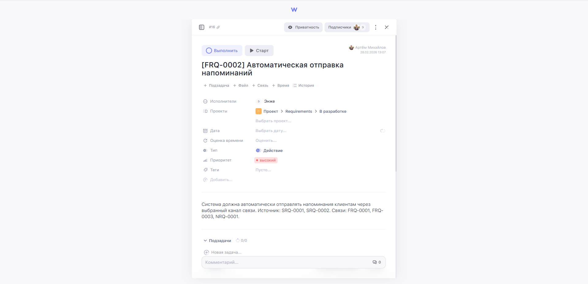
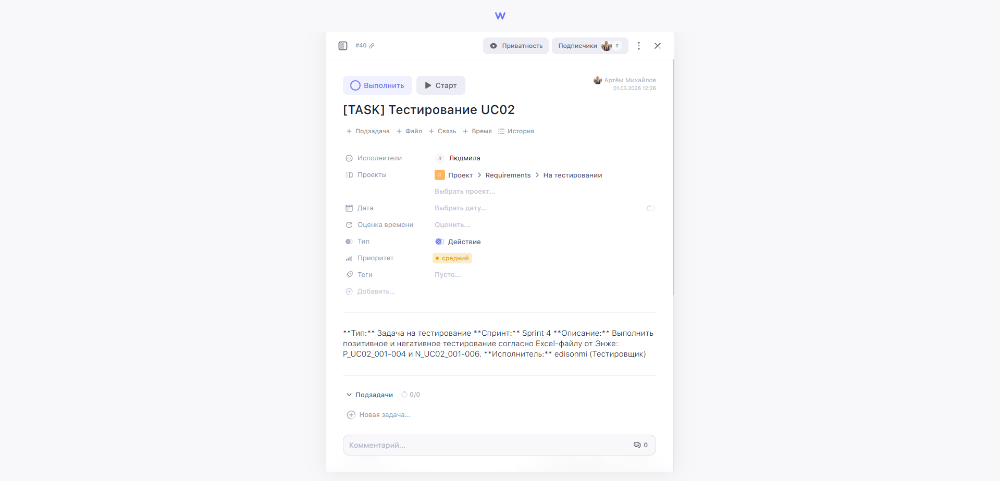

## БСА13_Управление требованиями, качеством, задачами

## 1. Управление требованиями

Требования в проекте делятся на уровни:

* **Бизнес-требования (BRD):** Цели и задачи организации.
* **Требования заинтересованных сторон:** Потребности пользователей и ролей.
* **Функциональные требования (FR):** Что система должна делать (механизмы, права доступа, логика).
* **Нефункциональные требования (NFR):** Как система должна работать (производительность, безопасность).

**Связи (трассировка):**
Требования разных уровней связаны. Например, требование заинтересованной стороны *«Администратор управляет правами ролей»* реализуется функциональными требованиями *«Создание роли»*, *«Назначение прав»* и *«Аудит доступа»*.

**Идентификация:**
Каждое требование имеет уникальный ID (например, `BRD-001`, `FR-042`). Атрибуты: автор, приоритет, статус (Черновик, Согласовано, В разработке, Реализовано), версия.

**Инструменты:** Jira, WEEEK, DOORS, СУТр.

## 2. Тестирование

Цель тестирования — не гарантия качества, а оценка соответствия системы требованиям и информирование о дефектах.

* **Ошибка (Error):** Действие человека, приводящее к неверному результату.
* **Дефект (Defect):** Изъян в системе, обнаруженный при тестировании.
* **Отказ (Failure):** Проявление дефекта во время работы системы.

Аналитик участвует в подготовке тест-кейсов (позитивных и негативных), проверке результатов и оформлении дефектов.

## 3. Управление задачами

Системы управления заданиями (Jira, WEEEK) используются для:

* Регистрации требований и дефектов.
* Назначения исполнителей (аналитик -> разработчик -> тестировщик).
* Отслеживания статусов (Open, In Progress, Resolved, Closed).

---

### Файлы упражнений

### Выделение типов требований

В рамках проекта «Запись на стрижку» выделены следующие группы требований, идентификаторы, атрибуты и статусы.

---

#### 1. Типы требований и идентификаторы

| № | Тип требования                                             | Идентификатор | Описание                                                                                            |
| -- | ----------------------------------------------------------------------- | :------------------------: | ----------------------------------------------------------------------------------------------------------- |
| 1  | Бизнес-требования                                       |       **BRQ**       | Цели и задачи продукта, бизнес-правила                                      |
| 2  | Требования заинтересованных сторон      |       **SRQ**       | User Stories, Use Cases, описания бизнес-процессов                                   |
| 3  | Функциональные требования к системе     |       **FRQ**       | Спецификации функций системы, интерфейсы                                |
| 4  | Нефункциональные требования к системе |       **NRQ**       | Атрибуты качества (производительность, безопасность и др.) |

Формат идентификатора: **XXX-NNNN**, где XXX — трёхбуквенный код типа, NNNN — порядковый номер (4 цифры с ведущими нулями).

Примеры: `BRQ-0001`, `SRQ-0003`, `FRQ-0012`, `NRQ-0005`.

---

#### 2. Атрибуты требований

##### 2.1. Состояние

| Атрибут                                                         | Описание                                                               | Пример значения |
| ---------------------------------------------------------------------- | ------------------------------------------------------------------------------ | ----------------------------- |
| Дата и время создания                                | Момент регистрации требования                       | 28.02.2026 10:00              |
| Дата и время перевода в текущий статус | Момент последнего изменения статуса            | 01.03.2026 14:30              |
| Статус требования                                      | Текущее состояние (см. раздел 3)                       | На анализе           |
| Приоритет требования                                | Срочность реализации (1 — высший, 5 — низший) | 1                             |
| Версия продукта                                          | Версия, в которую включено требование          | v1.0                          |
| Патч (спринт/выпуск)                                   | Итерация, в рамках которой реализуется        | Sprint 3                      |

##### 2.2. Описание и обоснование

| Атрибут                                                  | Описание                                                                   | Пример значения                                                                                                                                     |
| --------------------------------------------------------------- | ---------------------------------------------------------------------------------- | ----------------------------------------------------------------------------------------------------------------------------------------------------------------- |
| Краткое наименование (≤50 символов) | Лаконичное название требования                         | Автоматическая отправка напоминаний                                                                                              |
| Описание (≤150 символов)                       | Развернутая формулировка требования               | Система отправляет напоминание клиенту через выбранный канал связи за N часов до записи |
| Размещение материалов                       | Ссылка на документ, схему, макет                         | WEEEK                                                                                                                                                             |
| Метод проверки / Критерий приемки   | Как убедиться, что требование выполнено          | Клиент получает напоминание в Telegram за 24 часа до визита                                                               |
| Источник / Вышестоящее требование  | Связь с требованием верхнего уровня                 | BRQ-0001                                                                                                                                                          |
| Связи требования                                 | Горизонтальные связи с другими требованиями | FRQ-0003, NRQ-0002                                                                                                                                                |

##### 2.3. Ответственные лица

| Атрибут                                  | Описание                                                    | Пример значения              |
| ----------------------------------------------- | ------------------------------------------------------------------- | ------------------------------------------ |
| Текущий исполнитель           | Кто сейчас работает над требованием  | Иванов А.С.                        |
| Лицо, принимающее решение | Кто утверждает/отклоняет требование | Петров В.И. (Product Owner)        |
| Автор требования                 | Кто зарегистрировал требование          | Сидорова М.К. (Аналитик) |

---

#### 3. Статусы требований

| Статус                            | Описание                                                                                                |
| --------------------------------------- | --------------------------------------------------------------------------------------------------------------- |
| **Новое**                    | Требование зарегистрировано, ожидает рассмотрения                  |
| **На анализе**           | Аналитик прорабатывает и детализирует требование                    |
| **В разработке**       | Требование передано разработчикам для реализации                    |
| **На тестировании** | Реализация проверяется тестировщиками                                        |
| **Включено в патч**  | Требование реализовано и включено в конкретный релиз/спринт |
| **Отклонено**            | Требование отклонено (неактуально, дублирует другое)               |
| **Отложено**              | Реализация перенесена на более поздний срок                               |
| **Завершено**            | Требование полностью реализовано, протестировано и принято  |

Диаграмма переходов статусов:

```
Новое → На анализе → В разработке → На тестировании → Включено в патч → Завершено
              ↓               ↓               ↓
          Отклонено       Отложено        Отклонено
```

---

#### 4. Доска управления требованиями (WEEEK)



---

### Создание требований и регистрация

Требования описаны для выделенного курсивом предложения Задачи 1:

> *Система должна обеспечивать автоматическую отправку напоминаний клиентам через выбранный клиентом канал связи (Telegram, WhatsApp, VK, СМС) по настроенному менеджером расписанию.*

---

#### 1. Требования заинтересованных сторон (User Stories)

**SRQ-0001. Информирование менеджером клиентов о записи на услугу**

> Как **менеджер**, я хочу **настроить автоматическую отправку напоминаний клиентам о предстоящей записи**, чтобы **снизить количество пропущенных визитов и не тратить время на обзвон вручную**.

* Приоритет: 1
* Источник: BRQ-0001
* Связи: FRQ-0001, FRQ-0002, SRQ-0004

**SRQ-0002. Получение клиентом информирования о записи на услугу**

> Как **клиент**, я хочу **получать напоминание о записи в барбершоп заранее через удобный мне канал связи**, чтобы **не забыть о визите и при необходимости перенести запись**.

* Приоритет: 1
* Источник: BRQ-0001
* Связи: SRQ-0003, FRQ-0002

**SRQ-0003. Взаимодействие по каналам информирования**

> Как **клиент**, я хочу **выбрать предпочтительный канал связи (Telegram, WhatsApp, VK, СМС) при записи**, чтобы **получать напоминания именно там, где мне удобно**.

* Приоритет: 2
* Источник: BRQ-0001
* Связи: SRQ-0002, FRQ-0002, FRQ-0003

**SRQ-0004. Настройка расписания информирования**

> Как **менеджер**, я хочу **настраивать расписание отправки напоминаний (за сколько часов/дней до визита, количество напоминаний)**, чтобы **гибко управлять частотой информирования и не надоедать клиентам**.

* Приоритет: 2
* Источник: BRQ-0001
* Связи: SRQ-0001, FRQ-0001

---

#### 2. Функциональные требования к системе

**FRQ-0001. Настройка расписания напоминаний**

* **Описание:** Система должна предоставлять менеджеру возможность создавать и редактировать шаблоны расписания напоминаний: указать количество напоминаний, интервалы до визита (например, за 24 ч, за 2 ч), текст сообщения.
* Приоритет: 1
* Источник: SRQ-0001, SRQ-0004
* Связи: FRQ-0002, FRQ-0004
* Критерий приемки: Менеджер успешно создает расписание; настройки сохраняются и отображаются при повторном открытии.

**FRQ-0002. Автоматическая отправка напоминаний**

* **Описание:** Система должна автоматически отправлять напоминания клиентам через выбранный ими канал связи (Telegram, WhatsApp, VK, СМС) в соответствии с настроенным менеджером расписанием.
* Приоритет: 1
* Источник: SRQ-0001, SRQ-0002
* Связи: FRQ-0001, FRQ-0003, NRQ-0001
* Критерий приемки: Клиент получает напоминание в выбранном канале за указанное в расписании время до визита.

**FRQ-0003. Выбор и сохранение канала связи клиентом**

* **Описание:** Система должна предоставлять клиенту возможность выбрать предпочтительный канал связи из списка (Telegram, WhatsApp, VK, СМС) и сохранять этот выбор в профиле клиента.
* Приоритет: 2
* Источник: SRQ-0003
* Связи: FRQ-0002, FRQ-0005
* Критерий приемки: Выбранный канал сохраняется; при последующей записи значение подставляется автоматически.

---

#### 3. Требования к интерфейсам системы

**FRQ-0004. Экран настройки расписания напоминаний (Менеджер)**

* **Описание:** В панели менеджера должен быть экран «Настройка напоминаний» с возможностью: добавить/удалить интервал, указать время до визита, выбрать шаблон текста, включить/выключить напоминание.
* Приоритет: 2
* Источник: FRQ-0001, SRQ-0004
* Связи: FRQ-0001
* Критерий приемки: Экран отображается корректно; все элементы управления доступны и функционируют.

**FRQ-0005. Поле выбора канала связи при записи (Клиент)**

* **Описание:** На экране записи на услугу должно быть поле «Канал связи для напоминания» с выпадающим списком (Telegram, WhatsApp, VK, СМС). По умолчанию — значение из профиля клиента.
* Приоритет: 2
* Источник: FRQ-0003, SRQ-0003
* Связи: FRQ-0002, FRQ-0003
* Критерий приемки: Поле отображается на экране записи; значение сохраняется вместе с записью.

---

#### 4. Нефункциональные требования

**NRQ-0001. Надежность отправки напоминаний**

* **Описание:** В случае недоступности выбранного канала связи система должна выполнить повторную попытку отправки через 15 минут (до 3 попыток). При полной неудаче — отправить через резервный канал (СМС).
* Приоритет: 2
* Источник: BRQ-0001
* Связи: FRQ-0002
* Критерий приемки: При имитации сбоя канала система успешно переотправляет через резервный канал.

---

#### 5. Матрица трассировки требований

| Требование | Источник (вышестоящее) | Горизонтальные связи |
| -------------------- | :---------------------------------------: | --------------------------------------- |
| BRQ-0001             |                    —                    | SRQ-0001, SRQ-0002, SRQ-0003, SRQ-0004  |
| SRQ-0001             |                 BRQ-0001                 | SRQ-0004, FRQ-0001, FRQ-0002            |
| SRQ-0002             |                 BRQ-0001                 | SRQ-0003, FRQ-0002                      |
| SRQ-0003             |                 BRQ-0001                 | SRQ-0002, FRQ-0002, FRQ-0003            |
| SRQ-0004             |                 BRQ-0001                 | SRQ-0001, FRQ-0001                      |
| FRQ-0001             |            SRQ-0001, SRQ-0004            | FRQ-0002, FRQ-0004                      |
| FRQ-0002             |            SRQ-0001, SRQ-0002            | FRQ-0001, FRQ-0003, NRQ-0001            |
| FRQ-0003             |                 SRQ-0003                 | FRQ-0002, FRQ-0005                      |
| FRQ-0004             |                 FRQ-0001                 | FRQ-0001                                |
| FRQ-0005             |                 FRQ-0003                 | FRQ-0002, FRQ-0003                      |
| NRQ-0001             |                 BRQ-0001                 | FRQ-0002                                |

---

#### 6. Доказательство регистрации требований в WEEEK





---

### Позитивные тест-кейсы

| ID                   | Краткое название                                                                                                                  | Приоритет | Менеджер | Статус           | Шаги выполнения                                                                                                                                                                                                                                                                                                                                                                                           | ОР                                                                                                                                                                                                                                                                                                                                                                                                                                              | Постусловия                                                                                                                                                              |
| -------------------- | ------------------------------------------------------------------------------------------------------------------------------------------------ | ------------------ | ---------------- | ---------------------- | ----------------------------------------------------------------------------------------------------------------------------------------------------------------------------------------------------------------------------------------------------------------------------------------------------------------------------------------------------------------------------------------------------------------------- | ------------------------------------------------------------------------------------------------------------------------------------------------------------------------------------------------------------------------------------------------------------------------------------------------------------------------------------------------------------------------------------------------------------------------------------------------- | ----------------------------------------------------------------------------------------------------------------------------------------------------------------------------------- |
| **P_UC02_001** | Успешное создание свободного временного слота для мастера                                     | Высокий     | Менеджер | Выполнено     | 1. Перейти в раздел «Управление расписанием».`<br>`2. В поле «Дата» выбрать дату: (текущая дата + 1 день). `<br>`3. В поле «Время начала» выбрать 10:00.`<br>`4. В поле «Мастер» выбрать Алексей Иванов.`<br>`5. Нажать кнопку «Закрепить слот». | 1. Система выполняет проверку и не находит конфликтов.`<br>`2. Появляется сообщение: «Слот успешно закреплен за мастером».`<br>`3. В расписании мастера Алексей Иванов на указанную дату и время отображается заблокированный для клиентов слот. | Удалить созданный слот через интерфейс администратора или через БД для чистоты следующего теста. |
| **P_UC02_002** | Успешное создание слота для мастера с граничным временем (начало рабочего дня) | Средний     | Менеджер | Выполняется | 1. Перейти в раздел «Управление расписанием».`<br>`2. Выбрать дату: (текущая дата + 2 дня).`<br>`3. Выбрать время: 09:00.`<br>`4. Выбрать мастера: Иван Петров.`<br>`5. Нажать «Закрепить слот».                                                                                         | 1. Система подтверждает создание слота.`<br>`2. Слот 09:00 отображается в расписании мастера Иван Петров.                                                                                                                                                                                                                                                           | Очистить тестовые данные (удалить созданный слот).                                                                                        |
| **P_UC02_003** | Создание нескольких последовательных слотов для одного мастера                           | Средний     | Менеджер | Не начато      | 1. Создать слот для мастера Сергей Кузнецов на завтра, 13:00 (по сценарию P_UC02_001).`<br>`2. После успешного создания, не обновляя страницу, сразу создать слот для того же мастера на завтра, 14:00.                                                                          | 1. Первый слот создан успешно.`<br>`2. Второй слот создан успешно.`<br>`3. В расписании мастера на завтра отображаются два занятых часа подряд (13:00-14:00 и 14:00-15:00).                                                                                                                                                          | Удалить все созданные слоты для мастера Сергей Кузнецов на тестовую дату.                                             |
| **P_UC02_004** | Проверка селектора списка мастеров                                                                                | Низкий       | Менеджер | Не начато      | 1. Открыть страницу создания слота.`<br>`2. Нажать на выпадающий список «Мастер».                                                                                                                                                                                                                                                                         | 1. В выпадающем списке отображаются только сотрудники с ролью «Мастер».`<br>`2. Сотрудник с ролью «Администратор» отсутствует в списке для выбора.                                                                                                                                                                          | Не требуется                                                                                                                                                             |

---

#### Задача на тестирование в WEEEK



*Исходная таблица: файл БСА13_02.xlsx в директории src/.*

---

### Негативные тест-кейсы (от Энже)

| ID                   | Краткое название                                                                                                                                         | Приоритет | Менеджер | Статус           | Шаги выполнения                                                                                                                                                                                                                                                                                                                                                                                                                  | ОР                                                                                                                                                                                                                                                                                                                                                                              | Постусловия                                                                                                                                                                            |
| -------------------- | ----------------------------------------------------------------------------------------------------------------------------------------------------------------------- | ------------------ | ---------------- | ---------------------- | ---------------------------------------------------------------------------------------------------------------------------------------------------------------------------------------------------------------------------------------------------------------------------------------------------------------------------------------------------------------------------------------------------------------------------------------------- | --------------------------------------------------------------------------------------------------------------------------------------------------------------------------------------------------------------------------------------------------------------------------------------------------------------------------------------------------------------------------------- | ------------------------------------------------------------------------------------------------------------------------------------------------------------------------------------------------- |
| **N_UC02_001** | Попытка создания слота на уже занятое время (конфликт с бронированием клиента)                        | Высокий     | Менеджер | Выполнено     | 1. Открыть страницу создания слота.`<br>`2. Выбрать дату: завтра.`<br>`3. Выбрать время: 15:00.`<br>`4. Выбрать мастера: Дмитрий Соколов.`<br>`5. Нажать кнопку «Закрепить слот».                                                                                                                                      | 1. Система выполняет проверку и обнаруживает конфликт.`<br>`2. Система НЕ создает слот.`<br>`3. Появляется сообщение об ошибке: "Выбранный слот забронирован клиентом. Невозмжно создать расписание"                   | Проверить, что у мастера Дмитрий Иванов на завтра, в 15 ч осталась запись клиента, а пустой слот не появился |
| **N_UC02_002** | Попытка создания слота в прошедшей дате                                                                                               | Средний     | Менеджер | Выполняется | 1. Открыть страницу создания слота.`<br>`2. В поле «Дата» попытаться ввести или выбрать вчерашняя дата.`<br>`3. Заполнить остальные поля корректно.`<br>`4. Нажать кнопку «Закрепить слот».                                                                                                      | 1. Система не давет выбрать прошедшую дату (например, календарь блокирует прошедшие дни.`<br>`2. ИЛИ, если дату ввели вручную, система выдает сообщение при попытке сохранить: "Нельзя создать слот в прошлом" | Не требуется, так как слот не создастся                                                                                                                           |
| **N_UC02_003** | Попытка создания слота без выбора мастера                                                                                           | Средний     | Менеджер | Не начато      | 1. Открыть страницу создания слота.`<br>`2. Выбрать дату: послезавтра.`<br>`3. Выбрать время: 11:00.`<br>`4. Поле «Мастер» оставить пустым (значение по умолчанию).`<br>`5. Нажать кнопку «Закрепить слот».                                                                                      | 1. Система не выполняет сохранение.`<br>`2. Поле "Мастер" подсвечивается красным.`<br>`3. Появляется сообщение "Необходимо выбрать мастера"                                                                                                                             | Не требуется                                                                                                                                                                           |
| **N_UC02_004** | Попытка создания слота для сотрудника, не являющегося мастером                                                    | Низкий       | Менеджер | Не начато      | 1. Открыть страницу создания слота.`<br>`2. Нажать на выпадающий список «Мастер».                                                                                                                                                                                                                                                                                                | 1. В выпадающем списке отсутсвует сотрудник Иванов Вадим                                                                                                                                                                                                                                                                           | Шаг №2 является финальным, так как выбрать админимтсратора технически невозможно                                             |
| **N_UC02_005** | Попытка создания слота нулевой длительности (если интерфейс позволяет)                                     | Средний     | Менеджер | Не начато      | 1. Открыть страницу создания слота.`<br>`2. Выбрать дату: послезавтра.`<br>`3. В поле «Время начала» ввести (или выбрать) 12:00.`<br>`4. Попытаться в поле «Время окончания» (если есть) ввести 12:00.`<br>`5. Выбрать мастера.`<br>`6. Нажать «Закрепить слот». | 1. Система не дает указать время окончания меньше или равное времени начала.`<br>`2. ИЛИ появляется сообщение: "Время окончания должно быть больше времени начала".                                                                              | Не ребуется                                                                                                                                                                             |
| **N_UC02_006** | Создание слота, пересекающегося с уже существующим слотом мастера (конфликт с расписанием) | Высокий     | Менеджер | Не начато      | 1. Открыть страницу создания слота.`<br>`2. Выбрать дату: послезавтра.`<br>`3. Выбрать время: 10:00.`<br>`4. Выбрать мастера: Николай Федоров.`<br>`5. Нажать «Закрепить слот».                                                                                                                                         | 1. Система проверяет занятость мастера в это время.`<br>`2. Обнаруживает, что на это время у мастера уже есть слот(пусть даже пустой).`<br>`3.Выдается ошибка: "У выбранного мастера уже есть слот на это время".    | Проверить, что новый слот не создан, старый слот на 10:00 остался без изменений                                                       |

---

#### Задача на тестирование в WEEEK


*Исходная таблица: файл БСА13_03 2.xlsx в директории src/.*

---

### Оценка результата

Для UC02 (настройка расписания и отправка напоминаний) рассмотрены результаты выполнения позитивного тест-кейса и составлены отчеты о дефектах.

---

#### Оценка результатов после выполнения п.п. 1, 2

##### Ситуация 1.1

> Система сообщает, что выбранный слот забронирован в системе клиентом. Однако при обращении к клиенту тот отрицает, что забронировал этот слот.

* **Результат тест-кейса:** ❌ Отрицательный
* **ФР:** Отрицательный результат. Дефект зарегистрирован — **DEF-0001**

##### Ситуация 1.2

> Система сообщает, что выбранный слот не забронирован в системе клиентом.

* **Результат тест-кейса:** ✅ Положительный
* **ФР:** Положительный результат. Слот свободен, менеджер может продолжить работу по назначению.

---

#### Оценка результатов после выполнения п.п. 1–5

##### Ситуация 2.1

> Система выполняет закрепление слота за мастером, при дальнейшей работе слот не отражается в списке свободных.

* **Результат тест-кейса:** ✅ Положительный
* **ФР:** Положительный результат. Слот корректно закреплен за мастером и исключен из списка свободных.

##### Ситуация 2.2

> Система не выполняет закрепление слота за мастером. При дальнейшей работе этот слот также можно выбрать из списка свободных.

* **Результат тест-кейса:** ❌ Отрицательный
* **ФР:** Отрицательный результат. Дефект зарегистрирован — **DEF-0002**

---

#### Отчеты о дефектах

##### DEF-0001

| Поле                                                   | Значение                                                                                                                                                                                                                                                                                                                                                                                                                                                                                                                                                                                                                                     |
| ---------------------------------------------------------- | ---------------------------------------------------------------------------------------------------------------------------------------------------------------------------------------------------------------------------------------------------------------------------------------------------------------------------------------------------------------------------------------------------------------------------------------------------------------------------------------------------------------------------------------------------------------------------------------------------------------------------------------------------- |
| **Идентификатор**                       | DEF-0001                                                                                                                                                                                                                                                                                                                                                                                                                                                                                                                                                                                                                                             |
| **Краткое описание**                  | Слот отображается как забронированный клиентом, хотя клиент не выполнял бронирование                                                                                                                                                                                                                                                                                                                                                                                                                                                                                       |
| **Предусловие**                           | Менеджер авторизован в системе. Клиент ранее был зарегистрирован. Слот был свободен до начала теста.                                                                                                                                                                                                                                                                                                                                                                                                                                                             |
| **Шаги воспроизведения**          | 1. Открыть расписание мастера. 2. Выбрать свободный слот. 3. Система отображает статус «Забронировано клиентом [ФИО]». 4. Связаться с клиентом — клиент не подтверждает бронирование.                                                                                                                                                                                                                                                                                                                |
| **Ожидаемый результат (ОР)**     | Слот должен отображаться как свободный, если бронирование не было выполнено клиентом. Статус бронирования должен соответствовать фактическим действиям пользователей.                                                                                                                                                                                                                                                                                                                               |
| **Фактический результат (ФР)** | Слот отображается как «Забронировано» с привязкой к клиенту, который не совершал данного действия.**Отличие от ОР:** некорректная привязка бронирования к клиенту.                                                                                                                                                                                                                                                                                                                                      |
| **Постусловия**                           | Вручную освободить слот через панель администратора. Проверить логи на предмет несанкционированных действий.                                                                                                                                                                                                                                                                                                                                                                                                                                          |
| **Окружение**                               | ОС: Windows 11, Браузер: Chrome 131, Разрешение: 1920×1080                                                                                                                                                                                                                                                                                                                                                                                                                                                                                                                                                                       |
| **Приоритет**                               | 1 (Критический — влияет на корректность бронирования)                                                                                                                                                                                                                                                                                                                                                                                                                                                                                                                                                    |
| **Важность**                                 | Критическая — может привести к потере клиентов и некорректному распределению времени мастеров                                                                                                                                                                                                                                                                                                                                                                                                                                                                      |
| **Описание**                                 | Обнаружена проблема целостности данных: система присваивает бронирование клиенту без его фактического действия. Возможные причины: race condition при одновременном доступе, ошибка в логике привязки сессии к бронированию, некорректная обработка незавершенных транзакций. Требуется анализ логов транзакций и проверка механизма блокировки слотов. |
| **Дополнительные материалы**  | Скриншот экрана расписания с некорректным бронированием, выгрузка из журнала операций за тестовый период.                                                                                                                                                                                                                                                                                                                                                                                                                                                 |

---

##### DEF-0002

| Поле                                                   | Значение                                                                                                                                                                                                                                                                                                                                                                                                                                                                                                                                                                         |
| ---------------------------------------------------------- | ---------------------------------------------------------------------------------------------------------------------------------------------------------------------------------------------------------------------------------------------------------------------------------------------------------------------------------------------------------------------------------------------------------------------------------------------------------------------------------------------------------------------------------------------------------------------------------------- |
| **Идентификатор**                       | DEF-0002                                                                                                                                                                                                                                                                                                                                                                                                                                                                                                                                                                                 |
| **Краткое описание**                  | Слот не закрепляется за мастером после назначения и остается в списке свободных                                                                                                                                                                                                                                                                                                                                                                                                                                      |
| **Предусловие**                           | Менеджер авторизован. Мастер зарегистрирован в системе. Слот находится в статусе «Свободен».                                                                                                                                                                                                                                                                                                                                                                                                              |
| **Шаги воспроизведения**          | 1. Открыть расписание мастера. 2. Выбрать свободный слот. 3. Назначить слот мастеру (выполнить закрепление). 4. Вернуться к списку свободных слотов. 5. Убедиться, что слот по-прежнему отображается как свободный.                                                                                                                                                                                                 |
| **Ожидаемый результат (ОР)**     | После закрепления слот должен исчезнуть из списка свободных и отображаться в расписании мастера как занятый.                                                                                                                                                                                                                                                                                                                                                                                |
| **Фактический результат (ФР)** | Слот остается в списке свободных после закрепления за мастером.**Отличие от ОР:** операция закрепления не сохраняется, слот доступен для повторного выбора.                                                                                                                                                                                                                                                                                        |
| **Постусловия**                           | Проверить состояние слота в БД напрямую. При необходимости вручную обновить статус.                                                                                                                                                                                                                                                                                                                                                                                                                               |
| **Окружение**                               | ОС: Windows 11, Браузер: Chrome 131, Разрешение: 1920×1080                                                                                                                                                                                                                                                                                                                                                                                                                                                                                                           |
| **Приоритет**                               | 1 (Критический — блокирует основной бизнес-процесс записи)                                                                                                                                                                                                                                                                                                                                                                                                                                                                               |
| **Важность**                                 | Критическая — приводит к возможности двойного бронирования одного слота                                                                                                                                                                                                                                                                                                                                                                                                                                                   |
| **Описание**                                 | Операция закрепления слота за мастером не фиксируется в базе данных. Возможные причины: ошибка в транзакции записи (commit не выполняется), некорректная работа кэша (отображаются устаревшие данные), отсутствие валидации на серверной стороне. Рекомендуется проверить серверные логи и состояние транзакций в СУБД. |
| **Дополнительные материалы**  | Скриншот списка свободных слотов до и после закрепления, лог сетевых запросов (DevTools → Network).                                                                                                                                                                                                                                                                                                                                                                                                                   |
