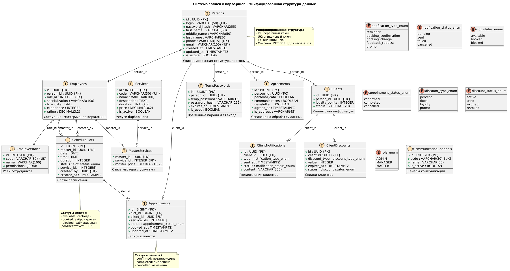

# БСА14_Интеграция ИТ-систем

### ER-диаграмма из БСА04 "Ситема записи в барбершоп"

# Exercise 03 — Словарь данных

## Задача 1. Запись на стрижку

Ниже представлен словарь данных для каждого из 9 потоков, приведенный в соответствие с ER-диаграммой.

---

## Поток 1: Регистрация клиента — Входящий

**Назначение:** Передача данных клиента от менеджера или через форму регистрации в систему.

| Блок / Атрибут                  | Тип данных | Длина | Обязательность | Ограничения / Условия                                |
| ------------------------------------------ | ------------------- | ---------- | ---------------------------- | ---------------------------------------------------------------------- |
| **client** (блок клиента) | Object              | —         | Обязательный     | Корневой блок                                              |
| &nbsp;&nbsp;id                             | UUID / String       | 36         | Необязательный | Первичный ключ, генерируется системой |
| &nbsp;&nbsp;phone                          | String              | 15         | Обязательный     | Формат: +7XXXXXXXXXX; уникальный                       |
| &nbsp;&nbsp;first_name                     | String              | 50         | Обязательный     | Имя клиента                                                  |
| &nbsp;&nbsp;last_name                      | String              | 50         | Необязательный | Фамилия клиента                                          |
| &nbsp;&nbsp;middle_name                    | String              | 50         | Необязательный | Отчество клиента                                        |
| &nbsp;&nbsp;email                          | String              | 100        | Необязательный | Email клиента                                                   |
| &nbsp;&nbsp;source                         | Enum                | —         | Обязательный     | Значения: 'web', 'manager'                                     |
| &nbsp;&nbsp;registered_at                  | TIMESTAMP           | —         | Обязательный     | Дата и время регистрации                          |

---

## Поток 2: Подтверждение регистрации / Временный пароль — Исходящий

**Назначение:** Отправка клиенту SMS с данными для входа после регистрации.

| Блок / Атрибут           | Тип данных | Длина | Обязательность | Ограничения / Условия                                                       |
| ----------------------------------- | ------------------- | ---------- | ---------------------------- | --------------------------------------------------------------------------------------------- |
| **registration_notification** | Object              | —         | Обязательный     |                                                                                               |
| &nbsp;&nbsp;recipient_phone         | String              | 15         | Обязательный     | Номер телефона клиента                                                    |
| &nbsp;&nbsp;first_name              | String              | 50         | Обязательный     | Имя клиента                                                                         |
| &nbsp;&nbsp;login                   | String              | 15         | Обязательный     | Номер телефона (логин)                                                      |
| &nbsp;&nbsp;temporary_password      | String              | 10         | Обязательный     | Сгенерированный временный пароль                                |
| &nbsp;&nbsp;message_text            | String              | 500        | Обязательный     | Текст сообщения с приветствием и данными для входа |

---

## Поток 3: Слоты расписания мастеров — Входящий

**Назначение:** Создание и закрепление свободных слотов за мастерами менеджером.

| Блок / Атрибут            | Тип данных | Длина | Обязательность | Ограничения / Условия                                           |
| ------------------------------------ | ------------------- | ---------- | ---------------------------- | --------------------------------------------------------------------------------- |
| **slot** (блок слота) | Object              | —         | Обязательный     |                                                                                   |
| &nbsp;&nbsp;id                       | BIGINT              | —         | Необязательный | Первичный ключ, генерируется системой            |
| &nbsp;&nbsp;master_id                | UUID                | 36         | Обязательный     | Внешний ключ к Employees                                              |
| &nbsp;&nbsp;date                     | DATE                | —         | Обязательный     | Дата слота; не может быть прошедшей                  |
| &nbsp;&nbsp;time                     | TIME                | —         | Обязательный     | Время начала слота; формат HH:MM:SS                         |
| &nbsp;&nbsp;duration                 | INTEGER             | —         | Обязательный     | Длительность слота в минутах; по умолчанию 60 |
| &nbsp;&nbsp;status                   | Enum                | —         | Обязательный     | slot_status_enum: 'free', 'booked', 'unavailable'                                 |
| &nbsp;&nbsp;service_ids              | INTEGER[]           | —         | Необязательный | Массив ID услуг, доступных в этом слоте             |
| &nbsp;&nbsp;created_by               | UUID                | 36         | Обязательный     | Внешний ключ к Personnel (менеджер)                           |
| &nbsp;&nbsp;created_at               | TIMESTAMP           | —         | Обязательный     | Дата и время создания слота                                |

---

## Поток 4: Список доступных слотов для записи — Исходящий

**Назначение:** Предоставление клиенту (через сайт) информации о свободных слотах мастеров.

| Блок / Атрибут                         | Тип данных | Длина | Обязательность | Ограничения / Условия                       |
| ------------------------------------------------- | ------------------- | ---------- | ---------------------------- | ------------------------------------------------------------- |
| **slots_list** (список слотов)  | Array               | —         | Обязательный     | Может быть пустым массивом             |
| **slot_item** (элемент списка) | Object              | —         | Обязательный     |                                                               |
| &nbsp;&nbsp;id                                    | BIGINT              | —         | Обязательный     | Идентификатор слота                         |
| &nbsp;&nbsp;master_id                             | UUID                | 36         | Обязательный     | Идентификатор мастера                     |
| &nbsp;&nbsp;master_name                           | String              | 150        | Обязательный     | ФИО мастера (first_name + last_name)                |
| &nbsp;&nbsp;master_specialization                 | String              | 100        | Обязательный     | Специализация мастера                     |
| &nbsp;&nbsp;master_rating                         | DECIMAL(3,2)        | —         | Обязательный     | Рейтинг мастера                                 |
| &nbsp;&nbsp;date                                  | DATE                | —         | Обязательный     | Дата слота                                           |
| &nbsp;&nbsp;time                                  | TIME                | —         | Обязательный     | Время начала слота                            |
| &nbsp;&nbsp;duration                              | INTEGER             | —         | Обязательный     | Длительность слота                           |
| &nbsp;&nbsp;available_services                    | Array               | —         | Обязательный     | Список услуг, доступных у мастера |

---

## Поток 5: Запись клиента на услугу — Входящий

**Назначение:** Фиксация выбора клиентом (или менеджером) мастера, услуги, даты и времени.

| Блок / Атрибут                     | Тип данных | Длина | Обязательность | Ограничения / Условия                                       |
| --------------------------------------------- | ------------------- | ---------- | ---------------------------- | ----------------------------------------------------------------------------- |
| **appointment** (блок записи) | Object              | —         | Обязательный     |                                                                               |
| &nbsp;&nbsp;id                                | BIGINT              | —         | Необязательный | Первичный ключ, генерируется системой        |
| &nbsp;&nbsp;slot_id                           | BIGINT              | —         | Обязательный     | Внешний ключ к ScheduleSlots                                      |
| &nbsp;&nbsp;client_id                         | UUID                | 36         | Обязательный     | Внешний ключ к Client                                             |
| &nbsp;&nbsp;service_ids                       | INTEGER[]           | —         | Обязательный     | Массив ID услуг из справочника услуг             |
| &nbsp;&nbsp;booked_at                         | TIMESTAMP           | —         | Обязательный     | Дата и время создания записи                          |
| &nbsp;&nbsp;updated_at                        | TIMESTAMP           | —         | Обязательный     | Дата и время последнего обновления записи |
| &nbsp;&nbsp;source                            | Enum                | —         | Обязательный     | Значения: 'web', 'manager'                                            |
| &nbsp;&nbsp;status                            | Enum                | —         | Обязательный     | Значения: 'booked', 'confirmed', 'completed', 'cancelled'             |

---

## Поток 6: Настройки каналов связи клиента — Входящий

**Назначение:** Выбор и сохранение клиентом предпочтительного канала для уведомлений.

| Блок / Атрибут       | Тип данных | Длина | Обязательность            | Ограничения / Условия                             |
| ------------------------------- | ------------------- | ---------- | --------------------------------------- | ------------------------------------------------------------------- |
| **notification_settings** | Object              | —         | Обязательный                |                                                                     |
| &nbsp;&nbsp;client_id           | UUID                | 36         | Обязательный                | Внешний ключ к Client                                   |
| &nbsp;&nbsp;type                | Enum                | —         | Обязательный                | notification_type_enum: 'pending', 'sent', 'failed', 'cancelled'    |
| &nbsp;&nbsp;preferred_channel   | Enum                | —         | Обязательный                | Значения: 'telegram', 'whatsapp', 'vk', 'sms'               |
| &nbsp;&nbsp;channel_address     | String              | 100        | Условно-обязательный | Telegram username / WhatsApp номер / VK ID                     |
| &nbsp;&nbsp;content             | String              | 300        | Необязательный            | Шаблон уведомления                                 |
| &nbsp;&nbsp;status              | Enum                | —         | Обязательный                | notification_status_enum: 'active', 'inactive'                      |
| &nbsp;&nbsp;updated_at          | TIMESTAMP           | —         | Обязательный                | Дата последнего обновления настроек |

---

## Поток 7: Напоминания о предстоящей записи — Исходящий

**Назначение:** Автоматическая отправка клиенту напоминания по выбранному каналу связи.

| Блок / Атрибут     | Тип данных | Длина | Обязательность | Ограничения / Условия                          |
| ----------------------------- | ------------------- | ---------- | ---------------------------- | ---------------------------------------------------------------- |
| **reminder**            | Object              | —         | Обязательный     |                                                                  |
| &nbsp;&nbsp;id                | UUID                | 36         | Обязательный     | Первичный ключ                                      |
| &nbsp;&nbsp;client_id         | UUID                | 36         | Обязательный     | Внешний ключ к Client                                |
| &nbsp;&nbsp;type              | Enum                | —         | Обязательный     | notification_type_enum: 'pending', 'sent', 'failed', 'cancelled' |
| &nbsp;&nbsp;scheduled_time    | TIMESTAMP           | —         | Обязательный     | Время отправки напоминания               |
| &nbsp;&nbsp;status            | Enum                | —         | Обязательный     | notification_status_enum: 'pending', 'sent', 'failed'            |
| &nbsp;&nbsp;content           | String              | 300        | Обязательный     | Сформированный текст напоминания   |
| &nbsp;&nbsp;channel           | Enum                | —         | Обязательный     | Telegram, WhatsApp, VK, SMS                                      |
| &nbsp;&nbsp;recipient_address | String              | 100        | Обязательный     | Адрес доставки (номер/username/ID)             |

---

## Поток 8: Данные об оказанной услуге и оплате — Исходящий

**Назначение:** Передача информации о выполненной услуге, стоимости и статусе оплаты в бухгалтерскую систему.

| Блок / Атрибут  | Тип данных | Длина | Обязательность | Ограничения / Условия        |
| -------------------------- | ------------------- | ---------- | ---------------------------- | ---------------------------------------------- |
| **service_report**   | Object              | —         | Обязательный     |                                                |
| &nbsp;&nbsp;appointment_id | BIGINT              | —         | Обязательный     | Идентификатор записи        |
| &nbsp;&nbsp;client_name    | String              | 150        | Обязательный     | ФИО клиента (first_name + last_name) |
| &nbsp;&nbsp;master_name    | String              | 150        | Обязательный     | ФИО мастера (first_name + last_name) |
| &nbsp;&nbsp;master_id      | UUID                | 36         | Обязательный     | Идентификатор мастера      |
| &nbsp;&nbsp;service_ids    | INTEGER[]           | —         | Обязательный     | Массив ID услуг                     |
| &nbsp;&nbsp;service_names  | String[]            | —         | Обязательный     | Названия услуг                    |
| &nbsp;&nbsp;service_date   | DATE                | —         | Обязательный     | Дата оказания услуги         |
| &nbsp;&nbsp;service_time   | TIME                | —         | Обязательный     | Время оказания услуги       |
| &nbsp;&nbsp;total_amount   | DECIMAL             | —         | Обязательный     | Общая стоимость услуг; >= 0 |
| &nbsp;&nbsp;payment_status | Enum                | —         | Обязательный     | 'paid', 'unpaid', 'partially_paid'             |
| &nbsp;&nbsp;payment_method | Enum                | —         | Необязательный | 'cash', 'card', 'online'                       |

---

## Поток 9: Отзывы и предложения клиентов — Входящий

**Назначение:** Получение обратной связи от клиента после посещения.

| Блок / Атрибут  | Тип данных | Длина | Обязательность | Ограничения / Условия                                |
| -------------------------- | ------------------- | ---------- | ---------------------------- | ---------------------------------------------------------------------- |
| **review**           | Object              | —         | Обязательный     |                                                                        |
| &nbsp;&nbsp;id             | UUID                | 36         | Необязательный | Первичный ключ, генерируется системой |
| &nbsp;&nbsp;appointment_id | BIGINT              | —         | Обязательный     | Внешний ключ к Appointments                                |
| &nbsp;&nbsp;client_id      | UUID                | 36         | Обязательный     | Внешний ключ к Client                                      |
| &nbsp;&nbsp;master_id      | UUID                | 36         | Обязательный     | Внешний ключ к Employees                                   |
| &nbsp;&nbsp;rating         | DECIMAL(3,2)        | —         | Обязательный     | Значения: 1.0–5.0                                             |
| &nbsp;&nbsp;comment        | String              | 2000       | Необязательный | Текст отзыва                                                |
| &nbsp;&nbsp;suggestions    | String              | 2000       | Необязательный | Предложения по улучшению                         |
| &nbsp;&nbsp;created_at     | TIMESTAMP           | —         | Обязательный     | Дата и время создания отзыва                   |

---

## Дополнительные сущности из ER-диаграммы, не вошедшие в потоки

### Сущность Personnel (Персонал)

| Атрибут | Тип данных | Длина | Описание                     |
| -------------- | ------------------- | ---------- | ------------------------------------ |
| id             | UUID                | 36         | Первичный ключ          |
| login          | VARCHAR             | 50         | Уникальный логин      |
| password_hash  | VARCHAR             | 255        | Хеш пароля                  |
| first_name     | VARCHAR             | 50         | Имя                               |
| middle_name    | VARCHAR             | 50         | Отчество                     |
| last_name      | VARCHAR             | 50         | Фамилия                       |
| phone          | VARCHAR             | 15         | Телефон, уникальный |
| email          | VARCHAR             | 100        | Email, уникальный          |
| created_at     | TIMESTAMP           | —         | Дата создания            |
| updated_at     | TIMESTAMP           | —         | Дата обновления        |
| is_active      | BOOLEAN             | —         | Активен/неактивен    |

### Сущность Employees (Сотрудники)

| Атрибут | Тип данных | Длина | Описание                      |
| -------------- | ------------------- | ---------- | ------------------------------------- |
| id             | UUID                | 36         | Первичный ключ           |
| person_id      | UUID                | 36         | Внешний ключ к Personnel  |
| role_id        | INTEGER             | —         | Внешний ключ к ролям |
| specialization | VARCHAR             | 100        | Специализация            |
| hire_date      | DATE                | —         | Дата найма                   |
| experience     | INTEGER             | —         | Опыт в годах                |
| rating         | DECIMAL(3,2)        | —         | Рейтинг мастера         |

### Сущность ClientDiscounts (Скидки клиентов)

| Атрибут | Тип данных | Длина | Описание                  |
| -------------- | ------------------- | ---------- | --------------------------------- |
| id             | UUID                | 36         | Первичный ключ       |
| client_id      | UUID                | 36         | Внешний ключ к Client |
| discount_type  | Enum                | —         | Тип скидки               |
| value          | INTEGER             | —         | Значение скидки     |
| expires_at     | TIMESTAMP           | —         | Дата истечения       |
| status         | Enum                | —         | Статус скидки         |
