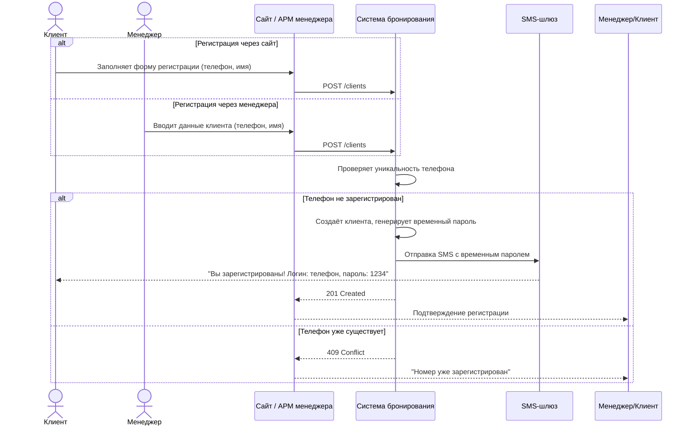

# БСА15_Интеграция веб-сервисами REST

## Теоретическая основа REST-интеграции

### 1. Архитектурный стиль REST

**REST (Representational State Transfer)** — архитектурный стиль для обеспечения стандартов взаимодействия между компьютерными системами в сети. Системы, отвечающие требованиям REST, называются RESTful.

**Шесть принципов REST (ограничения Филдинга):**

| Принцип                                                    | Описание                                                                                                                                                            |
| ----------------------------------------------------------------- | --------------------------------------------------------------------------------------------------------------------------------------------------------------------------- |
| **Клиент-серверная архитектура**  | Разделение зон ответственности: функции клиента и сервера разделены                                              |
| **Stateless**                                               | Сервер в каждом запросе получает всю информацию для обработки; не сохраняет состояние сессии |
| **Кэширование**                                  | Сохранение ответов сервером для дальнейшего использования, повышение производительности      |
| **Единообразие интерфейса (HATEOAS)** | Сервер возвращает не только ресурс, но и связи с другими ресурсами и допустимые действия          |
| **Слоистая архитектура**                 | Клиент и сервер не знают о промежуточных звеньях цепочки вызовов                                                     |
| **Код по требованию**                        | Передача исполняемого кода (опционально)                                                                                                 |

### 2. Основные понятия интеграции

| Понятие                                                 | Описание                                                                                                                                                 |
| -------------------------------------------------------------- | ---------------------------------------------------------------------------------------------------------------------------------------------------------------- |
| **Формат представления данных** | Способ передачи данных: JSON, XML, Binary                                                                                                    |
| **Протокол передачи данных**       | Совокупность соглашений, определяющих порядок обмена данными                                               |
| **Транспорт**                                   | Протоколы передачи данных по сети (HTTP, HTTPS)                                                                                     |
| **Ресурс**                                         | Объект, с которым выполняется взаимодействие (например,`/api/v1/clients`)                                       |
| **HTTP-глаголы**                                  | GET (чтение), POST (создание), PUT (полное обновление), PATCH (частичное обновление), DELETE (удаление) |
| **API**                                                  | Контракт взаимодействия между программами: операции, входные/выходные данные, ошибки    |

---

## Задача 1. Запись на стрижку — полный анализ интеграционных требований

### Выделение потоков данных

Для задачи «Запись на стрижку» выявлено **9 потоков данных**.

| № | Название потока данных                                                    | Назначение (цель)                                                                                                                                                  | Направление |
| -- | --------------------------------------------------------------------------------------------- | -------------------------------------------------------------------------------------------------------------------------------------------------------------------------------- | ---------------------- |
| 1  | **Регистрация клиента**                                               | Передача данных клиента (номер телефона, имя) от менеджера или через форму регистрации в систему | Входящий       |
| 2  | **Подтверждение регистрации / Временный пароль** | Отправка клиенту SMS с данными для входа после регистрации                                                                        | Исходящий     |
| 3  | **Слоты расписания мастеров**                                    | Создание и закрепление свободных слотов за мастерами менеджером                                                          | Входящий       |
| 4  | **Список доступных слотов для записи**                    | Предоставление клиенту (через сайт) информации о свободных слотах мастеров                                       | Исходящий     |
| 5  | **Запись клиента на услугу**                                       | Фиксация выбора клиентом (или менеджером) мастера, услуги, даты и времени                                            | Входящий       |
| 6  | **Настройки каналов связи клиента**                         | Выбор и сохранение клиентом предпочтительного канала для уведомлений (Telegram, WhatsApp, VK, SMS)                  | Входящий       |
| 7  | **Напоминания о предстоящей записи**                       | Автоматическая отправка клиенту напоминания по выбранному каналу связи                                            | Исходящий     |
| 8  | **Данные об оказанной услуге и оплате**                   | Передача информации о выполненной услуге, стоимости и статусе оплаты в бухгалтерскую систему     | Исходящий     |
| 9  | **Отзывы и предложения клиентов**                             | Получение обратной связи от клиента после посещения                                                                                 | Входящий       |

---

### Определение мастер-систем

Для каждого **входящего** потока определена мастер-система (источник данных).

| № | Название потока                               | Направление | Выбранная мастер-система       | Обоснование                                                                                                                                                                                                           |
| -- | ----------------------------------------------------------- | ---------------------- | ---------------------------------------------------- | -------------------------------------------------------------------------------------------------------------------------------------------------------------------------------------------------------------------------------- |
| 1  | Регистрация клиента                       | Входящий       | **Сайт / АРМ менеджера**       | Регистрация может инициироваться клиентом самостоятельно или менеджером; мастер-система — место первичного ввода данных |
| 3  | Слоты расписания мастеров            | Входящий       | **АРМ менеджера**                  | Менеджер на основе полученного графика работы создает и управляет расписанием мастеров                                                               |
| 5  | Запись клиента на услугу               | Входящий       | **Сайт / АРМ менеджера**       | Запись может быть создана клиентом или менеджером; оба являются легитимными источниками                                                              |
| 6  | Настройки каналов связи клиента | Входящий       | **Личный кабинет клиента** | Клиент самостоятельно выбирает удобный канал связи; это его персональное предпочтение                                                                 |
| 9  | Отзывы и предложения клиентов     | Входящий       | **Личный кабинет клиента** | Клиент оставляет отзыв самостоятельно после получения услуги                                                                                                               |

---

### Определение систем-получателей

Для каждого **исходящего** потока определена система-получатель.

| № | Название потока                                                       | Направление | Выбранные системы-получатели            | Обоснование                                                                                                                                                                                  |
| -- | ----------------------------------------------------------------------------------- | ---------------------- | ----------------------------------------------------------------- | ------------------------------------------------------------------------------------------------------------------------------------------------------------------------------------------------------- |
| 2  | Подтверждение регистрации / Временный пароль | Исходящий     | **SMS-шлюз**                                            | Клиент предоставил номер телефона; SMS — наиболее надежный способ доставки временного пароля                               |
| 4  | Список доступных слотов для записи                    | Исходящий     | **Сайт (интерфейс записи)**              | Клиент должен видеть актуальное расписание для выбора времени через основной интерфейс                                      |
| 7  | Напоминания о предстоящей записи                       | Исходящий     | **Внешние мессенджеры и SMS-шлюзы** | Система отправляет напоминания по каналам, которые выбрал клиент; интеграция с внешними API                                  |
| 8  | Данные об оказанной услуге и оплате                   | Исходящий     | **Бухгалтерская ИТ-система**          | Бухгалтерии необходимы данные о факте оказания услуги для финансового учета и начисления зарплаты мастерам |

**Проверка согласованности:**

| Связанные потоки                                                               | Мастер-система                | Система-получатель         | Проверка                                                                                                                                                      |
| --------------------------------------------------------------------------------------------- | ------------------------------------------ | ------------------------------------------- | --------------------------------------------------------------------------------------------------------------------------------------------------------------------- |
| Поток №5 (запись) ↔ Поток №7 (напоминания)                      | Сайт / АРМ менеджера       | Внешние мессенджеры / SMS | Согласовано. Запись создана, напоминание отправлено на основе выбранного клиентом канала |
| Поток №6 (настройки каналов) ↔ Поток №7 (напоминания) | Личный кабинет клиента | Внешние мессенджеры / SMS | Согласовано. Клиент сам выбрал канал, система использует его для отправки                               |

---

### Словарь данных (фрагмент)

#### Поток 1: Регистрация клиента — Входящий

| Блок / Атрибут | Тип данных | Длина | Обязательность | Ограничения                           |
| ------------------------- | ------------------- | ---------- | ---------------------------- | ------------------------------------------------ |
| **client**          | Object              | —         | Да                         | —                                               |
| phone                     | String              | 15         | Да                         | Формат: +7XXXXXXXXXX; уникальный |
| first_name                | String              | 50         | Да                         | Имя клиента                            |
| last_name                 | String              | 50         | Нет                       | Фамилия клиента                    |
| middle_name               | String              | 50         | Нет                       | Отчество клиента                  |
| email                     | String              | 100        | Нет                       | Email клиента                             |
| source                    | Enum                | —         | Да                         | Значения: 'web', 'manager'               |
| registered_at             | TIMESTAMP           | —         | Да                         | Дата и время регистрации    |

#### Поток 7: Напоминания о предстоящей записи — Исходящий

| Блок / Атрибут | Тип данных | Длина | Обязательность | Ограничения                                                 |
| ------------------------- | ------------------- | ---------- | ---------------------------- | ---------------------------------------------------------------------- |
| **reminder**        | Object              | —         | Да                         | —                                                                     |
| reminder_id               | UUID                | 36         | Да                         | Уникальный идентификатор напоминания |
| appointment_id            | BIGINT              | —         | Да                         | Идентификатор записи                                |
| client_id                 | UUID                | 36         | Да                         | Идентификатор клиента                              |
| channel                   | Enum                | 20         | Да                         | telegram, whatsapp, vk, sms                                            |
| recipient_address         | String              | 100        | Да                         | Адрес доставки (номер/username/ID)                   |
| message_text              | String              | 1000       | Да                         | Сформированный текст напоминания         |
| scheduled_time            | TIMESTAMP           | —         | Да                         | Время отправки напоминания                     |
| status                    | Enum                | 20         | Да                         | pending, sent, failed, retry                                           |
| retry_count               | Integer             | —         | Да                         | 0–3                                                                   |

---

### Сценарий интеграции (UC04)

**UC-1: Регистрация клиента менеджером или через сайт**

| Поле                 | Значение                                                                                                                                                       |
| ------------------------ | ---------------------------------------------------------------------------------------------------------------------------------------------------------------------- |
| Актор               | Менеджер / Клиент                                                                                                                                        |
| Предусловие   | Менеджер разговаривает с клиентом по телефону / Клиент на странице регистрации                      |
| Постусловие   | Клиент зарегистрирован в системе, получил временный пароль по SMS                                                 |
| Альтернатива | Номер телефона уже существует → система сообщает об этом и предлагает восстановить пароль |



---

### Требования к объему и количеству потоков

| № | Поток                                        | Среднее кол-во | Средний размер | Пиковое кол-во | Общий объем в месяц     |
| -- | ------------------------------------------------- | -------------------------- | --------------------------- | -------------------------- | --------------------------------------- |
| 1  | Регистрация клиента             | 3/час                   | 0.5 КБ                    | 15/час                  | ~1000 регистраций, ~0.5 МБ |
| 2  | Подтверждение регистрации | 3/час                   | 0.2 КБ                    | 15/час                  | ~1000 SMS, ~0.2 МБ                    |
| 3  | Слоты расписания                   | 50/день                | 0.3 КБ                    | 200/час                 | ~1500 слотов, ~0.5 МБ           |
| 4  | Список доступных слотов      | 200/час                 | 5-10 КБ                   | 1000/час                | ~100 000 запросов, ~700 МБ    |
| 5  | Запись на услугу                    | 30/час                  | 1 КБ                      | 150/час                 | ~9000 записей, ~9 МБ           |
| 6  | Настройки каналов                 | 2/час                   | 0.3 КБ                    | 10/час                  | ~500 изменений, ~0.15 МБ     |
| 7  | Напоминания                            | 60/час                  | 0.3-0.5 КБ                | 200/час                 | ~18 000 напоминаний, ~6 МБ |
| 8  | Данные в бухгалтерию            | 30/час                  | 1-2 КБ                    | 150/час                 | ~9000 записей, ~15 МБ          |
| 9  | Отзывы клиентов                     | 5/час                   | 2-5 КБ                    | 30/час                  | ~1500 отзывов, ~6 МБ           |

---

### Частота и сроки доставки

| № | Поток                                        | Желаемая частота                                    | Желаемые сроки            | Макс. сроки                                             |
| -- | ------------------------------------------------- | ------------------------------------------------------------------ | -------------------------------------- | ---------------------------------------------------------------- |
| 1  | Регистрация клиента             | По событию (онлайн-режим)                      | < 2 сек                             | < 5 сек                                                       |
| 2  | Подтверждение регистрации | По событию (сразу после регистрации) | < 10 сек                            | < 30 сек                                                      |
| 3  | Слоты расписания                   | Пакетно / по событию                               | < 1 сек                             | < 3 сек                                                       |
| 4  | Список доступных слотов      | По запросу (pull)                                         | < 1 сек                             | < 3 сек                                                       |
| 5  | Запись на услугу                    | По событию (онлайн-режим)                      | < 2 сек                             | < 5 сек                                                       |
| 6  | Настройки каналов                 | По событию                                                | < 1 сек                             | < 2 сек                                                       |
| 7  | Напоминания                            | По расписанию (каждые 15-30 минут)          | Минуты                           | < 15 мин от запланированного времени |
| 8  | Данные в бухгалтерию            | По событию / пакетно в конце дня          | До 08:00 следующего дня | До конца рабочего дня                          |
| 9  | Отзывы клиентов                     | По событию                                                | < 1 сек                             | < 2 сек                                                       |

---

### Описание методов API для UC01 (Регистрация клиента)

#### Метод 1: Проверка уникальности телефона

| Параметр                            | Значение                                                 |
| ------------------------------------------- | ---------------------------------------------------------------- |
| **Метод**                        | GET                                                              |
| **URL**                               | `/api/v1/clients/check-phone`                                  |
| **Параметры запроса** | `phone` (обязательный, формат: +7XXXXXXXXXX) |
| **Успешный ответ**       | 200 OK                                                           |

```json
{
  "isAvailable": true,
  "message": "Номер телефона свободен для регистрации"
}
```

| Код ошибки          | HTTP статус | Описание                                            |
| ---------------------------- | ----------------- | ----------------------------------------------------------- |
| `PHONE_ALREADY_REGISTERED` | 409 Conflict      | Номер уже зарегистрирован            |
| `INVALID_PHONE_FORMAT`     | 400 Bad Request   | Неверный формат номера телефона |

#### Метод 2: Регистрация нового клиента

| Параметр             | Значение                                                                 |
| ---------------------------- | -------------------------------------------------------------------------------- |
| **Метод**         | POST                                                                             |
| **URL**                | `/api/v1/clients`                                                              |
| **Заголовки** | `Content-Type: application/json`, `Idempotency-Key` (опционально) |

**Тело запроса:**

```json
{
  "phone": "+79161234567",
  "first_name": "Александр",
  "last_name": "Петров",
  "middle_name": "Иванович",
  "email": "alex@example.com",
  "source": "web"
}
```

**Успешный ответ (201 Created):**

```json
{
  "id": "550e8400-e29b-41d4-a716-446655440000",
  "phone": "+79161234567",
  "first_name": "Александр",
  "last_name": "Петров",
  "middle_name": "Иванович",
  "email": "alex@example.com",
  "registered_at": "2024-03-27T10:30:15Z",
  "temporary_password": "Ab3$kL9#",
  "message": "Регистрация успешно завершена. Временный пароль отправлен по SMS"
}
```

| Код ошибки          | HTTP статус       | Описание                                                  |
| ---------------------------- | ----------------------- | ----------------------------------------------------------------- |
| `VALIDATION_ERROR`         | 400 Bad Request         | Ошибка валидации входных данных       |
| `MISSING_REQUIRED_FIELD`   | 400 Bad Request         | Обязательное поле не заполнено         |
| `PHONE_ALREADY_REGISTERED` | 409 Conflict            | Номер телефона уже зарегистрирован |
| `SERVICE_UNAVAILABLE`      | 503 Service Unavailable | Сервис временно недоступен                |

---

### Описание методов API для UC03 (Создание расписания)

#### Метод 1: Проверка прав доступа

| Параметр                            | Значение                          |
| ------------------------------------------- | ----------------------------------------- |
| **Метод**                        | GET                                       |
| **URL**                               | `/api/v1/personnel/{id}/permissions`    |
| **Параметры запроса** | `permission` (обязательный) |
| **Успешный ответ**       | 200 OK                                    |

```json
{
  "hasPermission": true,
  "permission": "manage_schedule"
}
```

#### Метод 2: Получение списка мастеров

| Параметр                            | Значение                    |
| ------------------------------------------- | ----------------------------------- |
| **Метод**                        | GET                                 |
| **URL**                               | `/api/v1/employees`               |
| **Параметры запроса** | `role=MASTER`, `is_active=true` |
| **Успешный ответ**       | 200 OK                              |

```json
{
  "items": [
    {
      "id": "660e8400-e29b-41d4-a716-446655440001",
      "person_id": "550e8400-e29b-41d4-a716-446655440001",
      "first_name": "Дмитрий",
      "last_name": "Соколов",
      "specialization": "Мужская стрижка",
      "rating": 4.8
    }
  ],
  "total": 5
}
```

#### Метод 3: Создание слота расписания

| Параметр     | Значение           |
| -------------------- | -------------------------- |
| **Метод** | POST                       |
| **URL**        | `/api/v1/schedule-slots` |

**Тело запроса:**

```json
{
  "master_id": "660e8400-e29b-41d4-a716-446655440001",
  "date": "2024-04-15",
  "time": "10:00:00",
  "duration": 60,
  "service_ids": [101, 102]
}
```

**Успешный ответ (201 Created):**

```json
{
  "id": 2001,
  "master_id": "660e8400-e29b-41d4-a716-446655440001",
  "date": "2024-04-15",
  "time": "10:00:00",
  "duration": 60,
  "status": "free",
  "created_at": "2024-03-27T09:00:00Z"
}
```

#### Метод 4: Массовое создание слотов

| Параметр     | Значение                 |
| -------------------- | -------------------------------- |
| **Метод** | POST                             |
| **URL**        | `/api/v1/schedule-slots/batch` |

**Тело запроса:**

```json
{
  "master_id": "660e8400-e29b-41d4-a716-446655440001",
  "slots": [
    {"date": "2024-04-15", "time": "10:00:00", "duration": 60},
    {"date": "2024-04-15", "time": "11:00:00", "duration": 60},
    {"date": "2024-04-15", "time": "12:00:00", "duration": 60}
  ]
}
```

**Успешный ответ (201 Created):**

```json
{
  "status": "success",
  "created_slots": [
    {"id": 2001, "date": "2024-04-15", "time": "10:00:00"},
    {"id": 2002, "date": "2024-04-15", "time": "11:00:00"},
    {"id": 2003, "date": "2024-04-15", "time": "12:00:00"}
  ],
  "total_created": 3,
  "total_failed": 0
}
```

| Код ошибки  | HTTP статус | Описание                                                               |
| -------------------- | ----------------- | ------------------------------------------------------------------------------ |
| `ACCESS_DENIED`    | 403 Forbidden     | Недостаточно прав для выполнения операции |
| `MASTER_NOT_FOUND` | 404 Not Found     | Мастер не найден                                                 |
| `SLOT_CONFLICT`    | 409 Conflict      | Слот уже занят                                                     |
| `INVALID_DATE`     | 400 Bad Request   | Дата не может быть прошедшей                           |

---

### Маппинг данных

#### Регистрация клиента: Запрос → Сущность Client

| Поле запроса | Поле в БД  | Тип       | Преобразование                                                               | Обязательность |
| ----------------------- | ----------------- | ------------ | ------------------------------------------------------------------------------------------ | ---------------------------- |
| `phone`               | `phone`         | VARCHAR(15)  | Прямое сопоставление, валидация формата                 | Да                         |
| `first_name`          | `first_name`    | VARCHAR(50)  | Прямое сопоставление                                                    | Да                         |
| `last_name`           | `last_name`     | VARCHAR(50)  | Прямое сопоставление, NULL если не указано                 | Нет                       |
| `middle_name`         | `middle_name`   | VARCHAR(50)  | Прямое сопоставление, NULL если не указано                 | Нет                       |
| `email`               | `email`         | VARCHAR(100) | Приведение к нижнему регистру, валидация формата | Нет                       |
| `source`              | `source`        | ENUM         | Прямое сопоставление                                                    | Да                         |
| —                      | `id`            | UUID         | Генерация UUID v4                                                                 | Да                         |
| —                      | `registered_at` | TIMESTAMP    | CURRENT_TIMESTAMP                                                                          | Да                         |
| —                      | `password_hash` | VARCHAR(255) | bcrypt(сгенерированный пароль)                                        | Да                         |
| —                      | `login`         | VARCHAR(50)  | `login = phone`                                                                          | Да                         |

#### Маппинг ошибок

| Код ошибки           | HTTP статус       | Сообщение для клиента                                                                                                                                 |
| ----------------------------- | ----------------------- | ------------------------------------------------------------------------------------------------------------------------------------------------------------------------ |
| `PHONE_ALREADY_REGISTERED`  | 409 Conflict            | "Номер телефона уже зарегистрирован. Пожалуйста, войдите в систему или восстановите пароль" |
| `PHONE_IN_INACTIVE_ACCOUNT` | 409 Conflict            | "Аккаунт с таким номером деактивирован. Обратитесь к администратору"                                           |
| `VALIDATION_ERROR`          | 400 Bad Request         | "Ошибка валидации данных"                                                                                                                           |
| `MISSING_REQUIRED_FIELD`    | 400 Bad Request         | "Обязательное поле {field} не заполнено"                                                                                                      |
| `INVALID_PHONE_FORMAT`      | 400 Bad Request         | "Неверный формат номера телефона. Используйте формат +7XXXXXXXXXX"                                                          |
| `INVALID_EMAIL_FORMAT`      | 400 Bad Request         | "Неверный формат email"                                                                                                                                    |
| `MASTER_NOT_FOUND`          | 404 Not Found           | "Мастер с указанным ID не найден"                                                                                                                |
| `SLOT_CONFLICT`             | 409 Conflict            | "Выбранное время уже занято. Пожалуйста, выберите другой слот"                                                        |
| `SERVICE_UNAVAILABLE`       | 503 Service Unavailable | "Сервис временно недоступен. Пожалуйста, попробуйте позже"                                                              |
